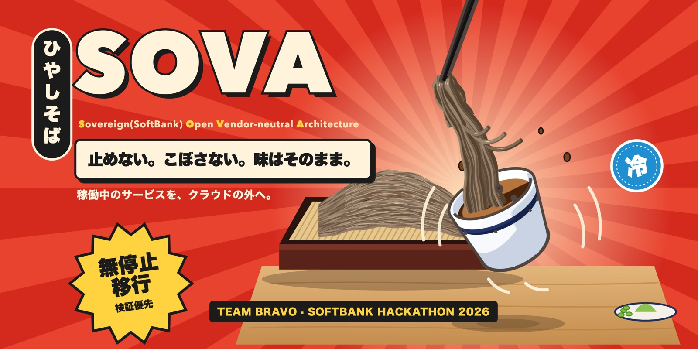
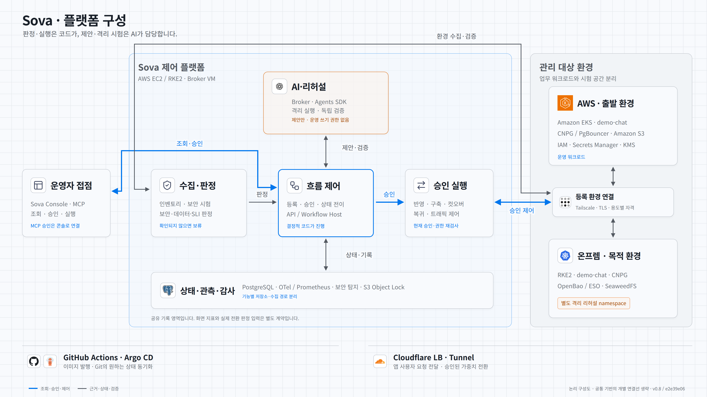
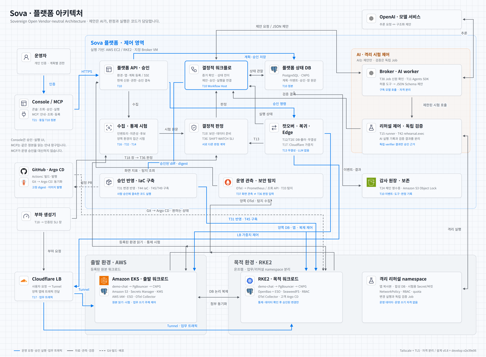

# SOVA · Cloud Exit Platform

[한국어](README.md) · **English** · [日本語](README.ja.md)

<p align="center"></p>

> **S**overeign(SoftBank) **O**pen **V**endor-neutral **A**rchitecture · SoftBank Hackathon 2026 Finals, Team Bravo

**SOVA moves a running service from AWS to on-premises without downtime. It switches traffic only after a verification gate confirms that the new environment is as secure and as accurate as the original.**

Financial services must be able to leave the cloud for regulatory, cost or contract reasons, and they need to rehearse that exit for real. Existing migration tools guarantee that data and workloads are moved. They do not guarantee that the destination keeps the same security posture and data correctness as the source. In SOVA, an AI agent only **proposes** fixes inside an isolated rehearsal environment. Deterministic code and human approval make every decision and perform every switch. If something goes wrong after the switch, SOVA returns to the source together with the data written in the meantime.

This repository holds the **platform code, infrastructure, design documents and task tracking**. The demo application that gets migrated lives in [`demo-chat`](https://github.com/Softbank-Hackathon-Finals/demo-chat).

## Security comes first

SOVA puts security first. **It does not switch until the same test shows that an access denied at the source is also denied at the destination.** The AI can only propose changes from an isolated environment; judgement and execution belong to deterministic code without an LLM and to human approval. [SECURITY.md](SECURITY.md) (Korean) describes every layer and its implementation status (real environment / tested / design only).

| Layer | What it does | Status |
|---|---|---|
| Strategy | Adapts the "diagnose → AI-proposed fix → isolated verification → approval → re-diagnose" cycle from SoftBank's **Patching as a Service** (announced 2026-07-14) to migration, and extends the design toward newly disclosed vulnerabilities (Day-0). "Day-0" is the team's interpretation; the announcement does not use the term | Design, partly tested |
| Security parity gate | Runs the same control tests (6 controls, 20 sub-tests) on the source and the destination, and blocks when results differ or cannot be confirmed | Partly real (3 tests on EKS and RKE2, intended BLOCK confirmed) |
| AI agent isolation | Tool allowlist, exactly one function call per turn, 600-second Job, isolated broker, sandbox VM (`network=none`), candidate build that never executes candidate code. Repeated evaluation with Harbor is planned | Partly real |
| Rehearsal isolation | A random namespace per rehearsal with PSA restricted, default-deny network policy and no service account token | Real |
| Safe cutover | Epoch fencing, intent recorded before every remote call, SAFE_HOLD when state cannot be confirmed, Edge weights limited to 0/10/50/100% | Executor run in real environment (once, demo mode); refusal and recovery paths tested |
| Detection and audit | Normalizes findings to OCSF (GuardDuty collected for real) and keeps audit records under S3 Object Lock in COMPLIANCE mode | Partly real |

Lee Sang-mu designed and implemented the security strategy, the source-comparison gate, the control tests, the detection integration and Security Review ([Security Governance v1](https://github.com/Softbank-Hackathon-Finals/security), [security documents](docs/security/README.md)). What is not yet guaranteed is listed under "알려진 한계" (known limitations) in [SECURITY.md](SECURITY.md#알려진-한계).

## Status and limitations

During the finals (2026-11-06 to 11-08) the team ran the happy path from a real AWS EKS source to an on-prem RKE2 destination. **No judgement ever passed by mistake, but the real environment never reached GATE PASS.** The real-environment run was confirmed up to S1 (collection, analysis, first GATE judgement with the intended BLOCK). The final demo used a demo mode that skips rehearsal, gate and watch; the component that actually executed in that demo was the cutover Executor. Failback and the Edge load measurement did not succeed in the real environment. The causes (big-bang integration, tests built on stand-ins, gate conditions that could never be satisfied together, incompatible image and configuration versions) and the next steps are described in the [retrospective](docs/retrospective.md) (Korean).

## Consoles

| Console | Author | Description |
|---|---|---|
| [SOVA Console (desktop)](services/console/desktop/README.md) | Ryu Ji-hwan | An Electron app that connects to the SOVA MCP with your own AWS SSO identity. You read status and draft registrations together with a guide agent. Includes a usage guide |
| [Sova migration operations console](services/console/README.md) | Lee Sang-mu | A web operations console attached to the platform host's T10 API. It shows control reports, detections, observations, failback and audit records, separated by evidence |

## Architecture

The **overview diagram** shows the nine functional groups and the main flows between them.

<picture>
  <source media="(prefers-color-scheme: dark)" srcset="docs/assets/architecture-overview-dark.png">
  
</picture>

When an operator starts a migration, the platform proceeds through collection → analysis → AI proposal → rehearsal → **source-comparison gate** → **human approval** → switch → watch and failback. The switch starts only after the gate passes and the approval is given. The source of truth is section 7.1 of the [design document](docs/design.html).

The **detailed diagram** shows the 20 components with their task numbers, and separates command, data and deployment paths.

<picture>
  <source media="(prefers-color-scheme: dark)" srcset="docs/assets/architecture-detail-dark.png">
  
</picture>

Both diagrams are logical views based on develop `e2e39e06` and design document v0.8; arrows do not represent the order of migration steps. Per-workload replacements (Cognito → Keycloak, SQS and Lambda → ElasticMQ and so on) and the details of VPCs, access and credential issuance are omitted. Placement (which account, VPC or machine runs what) is described in section 7.2 of the design document.

## Components

| Component | Role | Nature |
|---|---|---|
| Console and API | Environment registration, progress view, approvals and result lookup | Deterministic |
| State machine | Fixes the stages and transition conditions and stores the state; never advances without its condition | Deterministic |
| Collector | Reads source and destination configuration read-only | Deterministic |
| Agent worker | Dependency classification, translation and code-change proposals (JSON Schema), failure-cause estimation, approval summaries; no execution rights | AI |
| Rehearsal runner and tool layer | Creates an isolated namespace on the destination, scores the result with a verification Job, then deletes the namespace | Deterministic (AI attempts inside) |
| Control tester and source-comparison gate | Runs six security controls identically on source and destination and blocks the switch when the answers differ; no LLM | Deterministic |
| Cutover Executor | Runs the switch window that pauses writes for a few seconds, compares integrity and fails back; no LLM | Deterministic |
| Edge control | Moves traffic 10 → 50 → 100% with Cloudflare LB weights and reverts immediately when needed | Deterministic |
| Audit log | Keeps stage transitions, judgements, approvals, agent input/output and blocks in an undeletable store (S3 Object Lock) | Deterministic |

## Repository layout

```
platform/
├── infra/                      # Infrastructure following section 8.8 of the design document
│   ├── modules/                # Capability contracts and per-environment implementations
│   └── envs/                   # Per-environment apply units
├── docs/
│   ├── design.html             # Latest design document (open in a browser)
│   ├── design-history/         # Previous design document versions
│   ├── tasks.md                # Tasks and ownership (synced with issues)
│   ├── adr/                    # Architecture decision records
│   └── assets/                 # README images
├── services/                   # 22 platform services
├── scripts/                    # Task sync, design version bump and checks
├── .github/workflows/          # CI, image publishing, task sync
├── AGENTS.md                   # Instructions for coding agents
├── SECURITY.md                 # Layered security overview (Korean)
└── README.md
```

Each service under `services/` has its own folder and README. There are 22 services, including the consoles, the MCP server, the state machine, the agent worker, the control tester, the gate, the Executor, Edge control, the audit log and observability.

## Relationship with demo-chat

The platform treats `demo-chat` **like a customer's repository**, which is why the two repositories are separate.

| What | How |
|---|---|
| App analysis | The app is registered by repository URL and path, and its code is compared with what is actually deployed (T16) |
| Applying fixes | Only diffs that passed rehearsal and were approved are committed to a branch of the app repository (T31). The token is limited to read and branch write |
| Images | Source and destination receive the app image with the same digest (T7). Candidate images that contain a proposed fix are built by the platform without GitHub ([ADR-0052](docs/adr/0052-platform-candidate-build-without-github.md)) |

The conditions the app must meet (idempotency keys, reconnection, a write-block switch and so on) are in section 8.10 of the design document and in `AGENTS.md` of `demo-chat`.

## Workflows

| Workflow | Role |
|---|---|
| `ci.yml` | Runs three required checks on every PR and on pushes to main and develop. `secrets` checks the PR title, gitleaks and the evidence format; `infra` runs actionlint, hadolint, Terraform and Trivy config; `platform` finds `pyproject.toml`, `package.json` and `go.mod` and runs per-language lint, tests and Trivy fs |
| `publish-*.yml` | Scans each service image, attaches an SBOM and provenance, publishes it and opens a PR that pins the digest |
| `sync-tasks.yml` | Reflects `tasks.md` into issues after merge, and moves board items and updates `tasks.md` through a bot PR when issue checks or assignees change |

## Contributing

1. Find your task on the [project board](https://github.com/orgs/Softbank-Hackathon-Finals/projects/2) or in [`docs/tasks.md`](docs/tasks.md). The board (issues) is the source of truth for progress.
2. Create a `feature/T<number>-<description>` branch from `develop` and open a PR to `develop`. Merge with a merge commit after the target branch's ruleset, required CI and review requirements are met. `main` is updated only through release or hotfix branches. See the [Gitflow procedure](docs/development.md) and the [review guide](docs/review-playbook.md).
3. Prefix commit messages and PR titles with `[T<number>]`. Check finished items **in the issue**; board moves and `tasks.md` updates are automatic.
4. In Claude Code use `/todo-task`, and in Codex use `$todo-task`, to follow this process as a skill.

## Documents

- [Security](SECURITY.md): layered security design, implementation status, known limitations and how to report a vulnerability (Korean)
- [Retrospective and limitations](docs/retrospective.md): problems found during the finals happy path and the limits that remain (Korean)
- [Contract index](docs/contracts/README.md), [design document](docs/design.html), [ADRs](docs/adr/README.md), [tasks](docs/tasks.md)
- [Security design documents](docs/security/README.md): security strategy and design by Lee Sang-mu (Korean)
- [Agent instructions](AGENTS.md): working rules, design principles, security rules and verification commands
