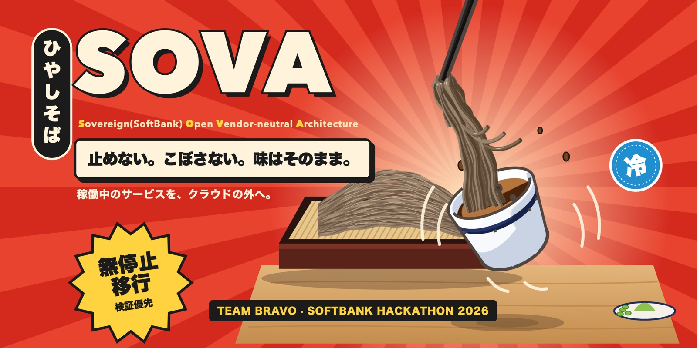
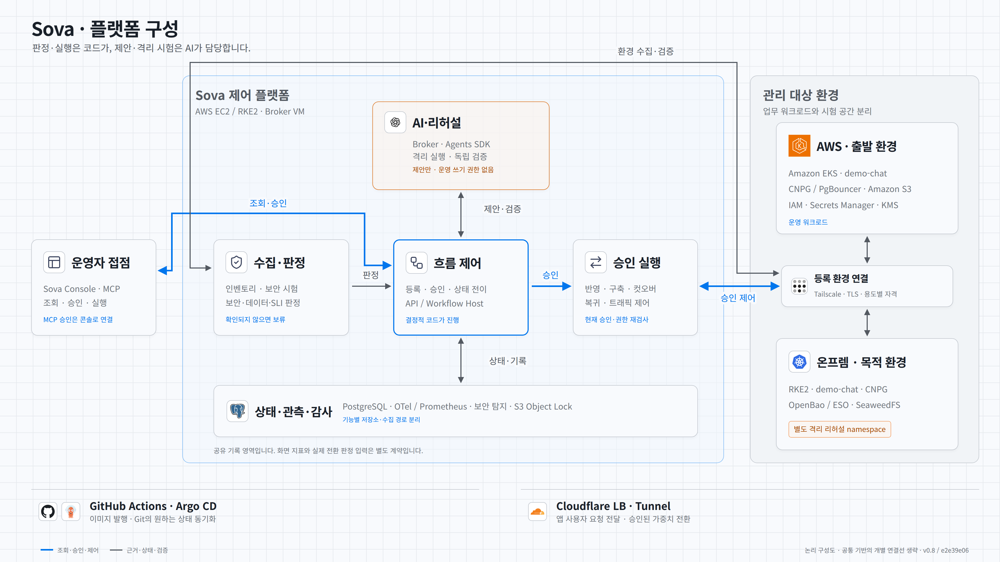
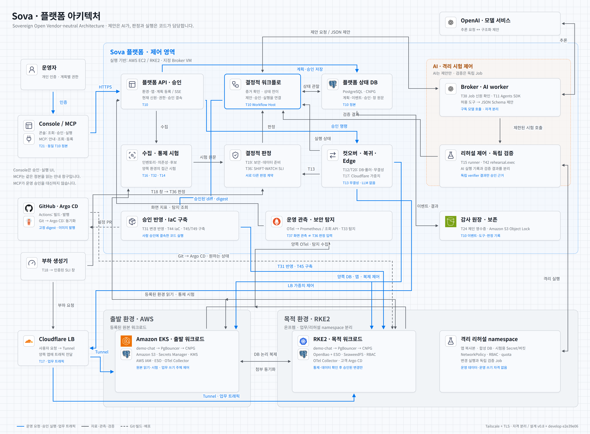

# SOVA · クラウド出口戦略プラットフォーム

[한국어](README.md) · [English](README.en.md) · **日本語**

<p align="center"></p>

> **S**overeign(SoftBank) **O**pen **V**endor-neutral **A**rchitecture · SoftBank Hackathon 2026 本選 Team Bravo

**SOVA は、稼働中のサービスを AWS からオンプレミスへ無停止で移行するプラットフォームです。移行先の環境が移行元と同じ水準で安全かつ正確であることを検証ゲートで確認した後にのみ、切り替えを行います。**

金融サービスは、規制やコスト、契約終了などの理由でクラウドから離れられる必要があり、その出口戦略を実際に試しておく必要があります。しかし既存の移行ツールが保証するのはデータとワークロードの移動までで、移行先が移行元と同じセキュリティ水準とデータの正確性を備えているかまでは保証しません。SOVA では、AI は隔離されたリハーサル環境で差分を埋める修正案を**提案**するだけで、判定と切り替えは決定的なコードと人の承認が担います。切り替え後に問題が起きた場合は、その間に書き込まれたデータも含めて移行元へ戻ります。

このリポジトリには、**プラットフォームのコード、インフラ、設計文書、タスク管理の記録**があります。移行対象のデモアプリは [`demo-chat`](https://github.com/Softbank-Hackathon-Finals/demo-chat) リポジトリにあります。

**▶ [インタラクティブ解説を開く](https://softbank-hackathon-finals.github.io/platform/presentation/sova-final-interactive.html)** · プラットフォームの構成と 7 段階の移行フローをクリックしながら追える発表用の解説です(GitHub Pages、原本 [`docs/presentation/sova-final-interactive.html`](docs/presentation/sova-final-interactive.html))。設計したフローを示すもので、実環境で確認できた範囲は下記の「現状と限界」にまとめています。

## セキュリティを最優先に

SOVA はセキュリティを最優先に掲げています。**移行元で拒否されていたアクセスが、移行先でも同じテストで拒否されることを確認するまでは切り替えません。** AI は隔離された環境から提案することしかできず、判定と実行は LLM を使わない決定的なコードと人の承認が担います。各レイヤーの設計と実装状況(実環境 / テスト / 設計)は [SECURITY.md](SECURITY.md)(韓国語)にまとめています。

| レイヤー | 内容 | 状況 |
|---|---|---|
| 戦略 | SoftBank が 2026-07-14 に発表した **Patching as a Service** に着想を得て、「診断 → AI による修正提案 → 隔離環境での検証 → 承認 → 再診断」のサイクルを移行プロセスに適用し、新たに公開された脆弱性(Day-0)への対応へと拡張して設計しました。Day-0 という表現は発表文にはなく、チームによる解釈です | 設計、一部テスト |
| セキュリティ同等性ゲート | 移行元と移行先で同じ統制テスト(統制 6 個、下位テスト 20 個)を実行し、結果が異なるか確認できない場合は BLOCK します | 一部実環境(EKS と RKE2 でテスト 3 個を実行し、意図した BLOCK を確認) |
| AI エージェントの隔離 | ツールの許可リスト、1 ターンにつき関数呼び出し 1 回、600 秒の Job、broker の隔離、サンドボックス VM(`network=none`)、候補コードを実行しないビルドでエージェントを閉じ込めます。Harbor による反復評価は計画段階です | 一部実環境 |
| リハーサルの隔離 | リハーサルごとにランダムな名前の名前空間を作り、PSA restricted とデフォルト拒否のポリシーを適用し、SA トークンを与えません | 実環境 |
| 安全な切り替え | epoch フェンシングと意図の事前記録を行い、状態を確認できない場合は SAFE_HOLD で停止し、Edge の重みは 0・10・50・100% のみ許可します | Executor の実行は実環境(デモモードで 1 回)、拒否と復旧の動作はテスト |
| 検知と監査 | 検知結果を OCSF に正規化し(GuardDuty は実際に収集)、移行元と移行先の DB 接続・DDL・Kubernetes 権限変更の監査ログを収集し、監査記録を S3 Object Lock の COMPLIANCE モードで保存します | 一部実環境 |

セキュリティ戦略、移行元との比較ゲート、統制テスト、検知の統合、移行元・移行先の監査ログ収集、Security Review は Lee Sang-mu(イ・サンム)が設計・実装しました([Security Governance v1](https://github.com/Softbank-Hackathon-Finals/security)、[セキュリティ文書](docs/security/README.md))。レイヤーごとの担当は [SECURITY.md の「계층 요약」(レイヤー概要)](SECURITY.md#계층-요약)にあります。まだ守れていない点は [SECURITY.md の「알려진 한계」(既知の限界)](SECURITY.md#알려진-한계)に記載しています。

## 現状と限界

本選期間(2026-11-06 〜 11-08)に、実際の AWS EKS からオンプレミスの RKE2 へ移行するハッピーパスを実行しました。**誤って通過した判定は一度もありませんでしたが、実環境では GATE PASS に到達できませんでした。** 実環境で確認できた範囲は S1(収集、分析、最初の GATE 判定と意図した BLOCK)までです。最終デモはリハーサル、ゲート、監視を省略するデモモードで実施し、そのデモで実際に動作したのはカットオーバー Executor です。フェイルバックと Edge の負荷測定は実環境では成立しませんでした。原因(ビッグバン統合、代替物に依存したテスト、同時に満たせないゲート条件、イメージと設定の非互換)と次の改善方針は[振り返りと限界](docs/retrospective.md)(韓国語)にまとめています。

## コンソール

| コンソール | 作成者 | 形態 |
|---|---|---|
| [SOVA Console(デスクトップ)](services/console/desktop/README.md) | Ryu Ji-hwan(リュ・ジファン) | Electron アプリです。自分の AWS SSO で SOVA MCP に接続し、案内役のエージェントと一緒に状態を確認しながら登録の下書きを作成します。使い方の案内を含みます |
| [Sova 移行運用コンソール](services/console/README.md) | Lee Sang-mu(イ・サンム) | プラットフォームホストの T10 API に接続する Web 運用画面です。統制レポート、検知、観測、フェイルバック、監査記録を根拠ごとに分けて表示します |

## 担当領域

セキュリティのレイヤーごとの担当は [SECURITY.md](SECURITY.md#계층-요약)に、タスクごとの担当の全体は [`docs/tasks.md`](docs/tasks.md) と[プロジェクトボード](https://github.com/orgs/Softbank-Hackathon-Finals/projects/2)にあります。セキュリティのレイヤーとコンソール以外で、担当を明記しておく領域は次のとおりです。

| 領域 | 担当 | 内容 |
|---|---|---|
| 移行先の構築 | Lee Sang-mu(イ・サンム、T44)、Jeon Dong-hun(チョン・ドンフン、T45) | 二人が範囲を分けて共同で作りました。[移行先 IaC API](docs/adr/0032-destination-iac-api.md)(T44)はモジュールカタログ、Git に置いた望ましい状態、計画 API、ネットワーク経路の宣言、顧客クラスターの Argo CD を担います。[移行先の初回構築実行器](docs/adr/0033-destination-bootstrap-executor.md)(T45)は空のクラスターから移行先を初めて立ち上げる段階スタックと実行を担い、移行先の Argo CD は T44 のインストールを共用します。Ryu Ji-hwan(リュ・ジファン)が tailnet ポリシーの GitOps、人の API アクセス、ノードファイル API を加えて T44 を拡張しました |
| 観測 | Lee Sang-mu(イ・サンム) | 判定用の観測契約と SHIFT・WATCH の判定規則(T36)、OpenTelemetry Collector で移行元と移行先のメトリクスをプラットフォームのメトリクスストアに集める収集(T37)です。契約は [`docs/observability/`](docs/observability/README.md)(韓国語)にあります |
| バックアップと復元 | Lee Sang-mu(イ・サンム) | 移行元と移行先の CNPG バックアップ・復元です(T35)。別クラスターに復元して読み出し照合する手順と、WAL 欠落時に復旧しないことをローカルの kind でテストしました |
| デモアプリ | Lee Sang-mu(イ・サンム) | 移行対象である [`demo-chat`](https://github.com/Softbank-Hackathon-Finals/demo-chat) の v0・v1 です(T4・T22) |
| マージ自動化 | Lee Sang-mu(イ・サンム。T41 は Ryu Ji-hwan と共同) | develop の Merge Queue と、承認を必須としない CI ベースのマージを導入しました(T40・T41、[ADR-0017](docs/adr/0017-develop-merge-queue.md))。11/7 に Merge Queue をルールから外したため、現在は使っていません |
| 個人プロトタイプ | Lee Sang-mu(イ・サンム) | [`sova-test`](https://github.com/Softbank-Hackathon-Finals/sova-test) は Lee Sang-mu の個人開発プロトタイプと統合・デモ環境を保存するリポジトリです |

## アーキテクチャ

**概要図**には、9 つの機能グループとその間の主な流れだけを示しています。

<picture>
  <source media="(prefers-color-scheme: dark)" srcset="docs/assets/architecture-overview-dark.png">
  
</picture>

運用チームが移行を開始すると、プラットフォームは収集 → 分析 → AI 提案 → リハーサル → **移行元との比較ゲート** → **人の承認** → 切り替え → 監視とフェイルバックの順に進みます。ゲートを通過し承認を得た場合にのみ、切り替えが始まります。原本は[設計文書](docs/design.html)の 7.1 節です。

**詳細図**には、20 個のコンポーネントとタスク番号を示し、コマンド、データ、デプロイの経路を分けて表示しています。

<picture>
  <source media="(prefers-color-scheme: dark)" srcset="docs/assets/architecture-detail-dark.png">
  
</picture>

2 つの図は develop `e2e39e06` と設計文書 v0.8 に基づく論理構成図であり、矢印は移行ステップの順序を表すものではありません。ワークロードの機能ごとの置き換え(Cognito → Keycloak、SQS と Lambda → ElasticMQ など)と、VPC、接続、認証情報の発行の詳細は省略しています。どのアカウント、VPC、マシンに何を配置するかは設計文書の 7.2 節で説明しています。

## 構成

| コンポーネント | 役割 | 性質 |
|---|---|---|
| コンソールと API | 環境の登録、進捗の表示、承認、結果の照会を提供します | 決定的 |
| 状態機械 | ステージと遷移条件を固定して状態を保存し、条件を満たさない限り次のステージへ進みません | 決定的 |
| 収集器 | 移行元と移行先の設定を読み取り専用で収集します | 決定的 |
| エージェントワーカー | 依存関係の分類、翻訳とコード修正の提案書(JSON Schema)、失敗原因の推定、承認用の要約を作成します。実行権限はありません | AI |
| リハーサルランナーとツール層 | 移行先に隔離された名前空間を作り、検証 Job で結果を採点した後に名前空間を削除します | 決定的(内部で AI が試行) |
| 統制テスターと比較ゲート | 6 つのセキュリティ統制を移行元と移行先で同じようにテストし、結果が異なれば切り替えを止めます。LLM は使いません | 決定的 |
| Cutover Executor | 書き込みを数秒だけ止める切り替え区間を実行し、整合性を比較し、必要ならフェイルバックします。LLM は使いません | 決定的 |
| Edge 制御 | Cloudflare LB の重みでトラフィックを 10 → 50 → 100% と移し、問題があればすぐに戻します | 決定的 |
| 監査ログ | ステージ遷移、判定、承認、エージェントの入出力、ブロックの記録を削除できない形で保存します(S3 Object Lock) | 決定的 |

## リポジトリ構成

```
platform/
├── infra/                      # 設計文書 8.8 節の構成に従うインフラ
│   ├── modules/                # 機能の契約と環境ごとの実装
│   └── envs/                   # 環境ごとの適用単位
├── docs/
│   ├── design.html             # 設計文書の最新版(ブラウザで開きます)
│   ├── design-history/         # 過去の設計文書のバージョン
│   ├── tasks.md                # タスクと役割分担(Issue と自動同期)
│   ├── adr/                    # アーキテクチャ決定記録
│   └── assets/                 # README の画像
├── services/                   # 22 個のプラットフォームサービス
├── scripts/                    # タスク同期、設計文書のバージョン更新、各種チェック
├── .github/workflows/          # CI、イメージ発行、タスク同期
├── AGENTS.md                   # コーディングエージェント向けの作業案内
├── SECURITY.md                 # レイヤー別のセキュリティ整理(韓国語)
└── README.md
```

`services/` の下には、サービスごとのフォルダと README があります。コンソール、MCP サーバー、状態機械、エージェントワーカー、統制テスター、ゲート、Executor、Edge 制御、監査ログ、観測など 22 個のサービスがあります。

## demo-chat との関係

プラットフォームは `demo-chat` を**顧客のリポジトリ**として扱うため、リポジトリを分けています。

| 対象 | 方法 |
|---|---|
| アプリの分析 | リポジトリの URL とパスでアプリを登録し、コードと実際のデプロイ状態を照合します(T16) |
| 修正の反映 | リハーサルに通過し承認された diff だけを、アプリリポジトリのブランチにコミットします(T31)。トークンの権限は読み取りとブランチへの書き込みに限定します |
| イメージ | 移行元と移行先は同じ digest のアプリイメージを受け取ります(T7)。修正案を反映した候補イメージは、GitHub を経由せずプラットフォームがビルドします([ADR-0052](docs/adr/0052-platform-candidate-build-without-github.md)) |

アプリが守るべき条件(冪等キー、再接続、書き込み停止スイッチなど)は、設計文書の 8.10 節と `demo-chat` の `AGENTS.md` にあります。

## ワークフロー

| ワークフロー | 役割 |
|---|---|
| `ci.yml` | PR と main・develop への push ごとに必須チェックを 3 つ実行します。`secrets` は PR タイトルの形式、gitleaks、証跡の形式を検査し、`infra` は actionlint、hadolint、Terraform、Trivy config を実行し、`platform` は `pyproject.toml`、`package.json`、`go.mod` を探して言語ごとの lint とテスト、Trivy fs を実行します |
| `publish-*.yml` | サービスイメージをスキャンし、SBOM と provenance を付けて発行した後、digest を固定する PR を作成します |
| `sync-tasks.yml` | `tasks.md` がマージされると計画を Issue に反映し、Issue のチェックや担当者が変わるとボードを移動して `tasks.md` をボットの PR で更新します |

## 作業の進め方

1. [プロジェクトボード](https://github.com/orgs/Softbank-Hackathon-Finals/projects/2)または [`docs/tasks.md`](docs/tasks.md) で担当タスクを探します。進捗はボード(Issue)を基準に判断します。
2. `develop` から `feature/T番号-説明` ブランチを作り、`develop` へ PR を出します。対象ブランチの ruleset、必須 CI、レビュー要件を満たした後、merge commit でマージします。`main` には release または hotfix ブランチで反映します。手順は [Gitflow の手順](docs/development.md)と[レビュー案内](docs/review-playbook.md)にあります。
3. コミットメッセージと PR タイトルの先頭に `[T番号]` を付けます。完了した項目は **Issue で**チェックし、ボードの移動と `tasks.md` の更新は自動で行われます。
4. Claude Code では `/todo-task`、Codex では `$todo-task` のスキルでこの手順を進められます。

## 文書

- [セキュリティ](SECURITY.md): レイヤー別のセキュリティ設計と実装状況、既知の限界、脆弱性の報告方法(韓国語)
- [振り返りと限界](docs/retrospective.md): 本選のハッピーパスで明らかになった問題と残っている限界(韓国語)
- [契約の目次](docs/contracts/README.md)、[設計文書](docs/design.html)、[ADR](docs/adr/README.md)、[タスク](docs/tasks.md)
- [セキュリティ設計文書](docs/security/README.md): Lee Sang-mu によるセキュリティ戦略と設計(韓国語)
- [エージェント作業案内](AGENTS.md): 作業ルール、設計原則、セキュリティルール、検証コマンド
