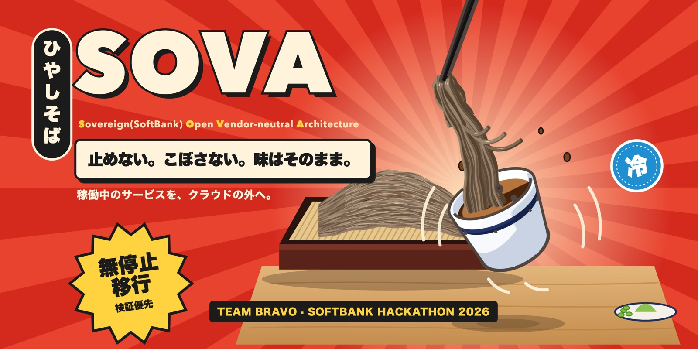
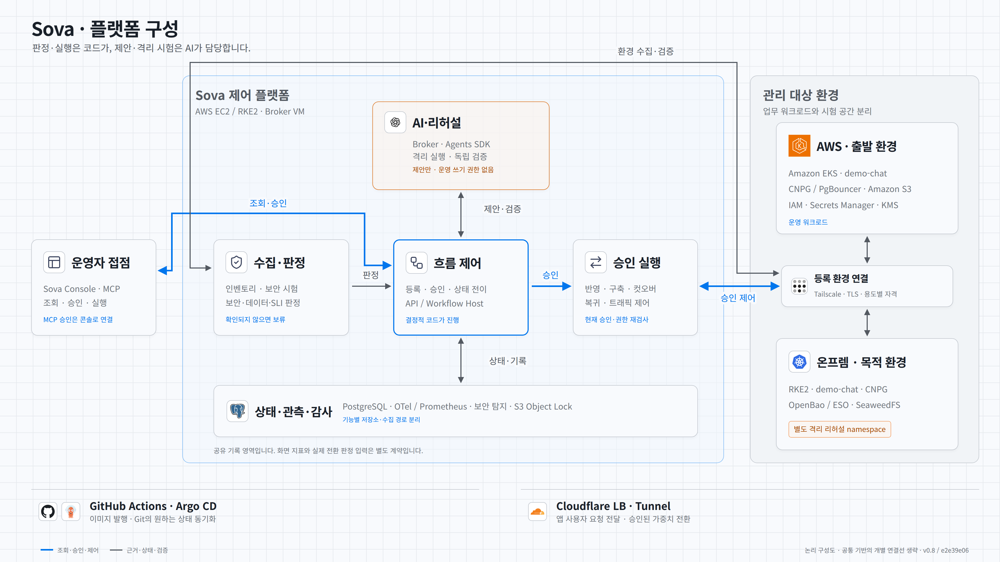
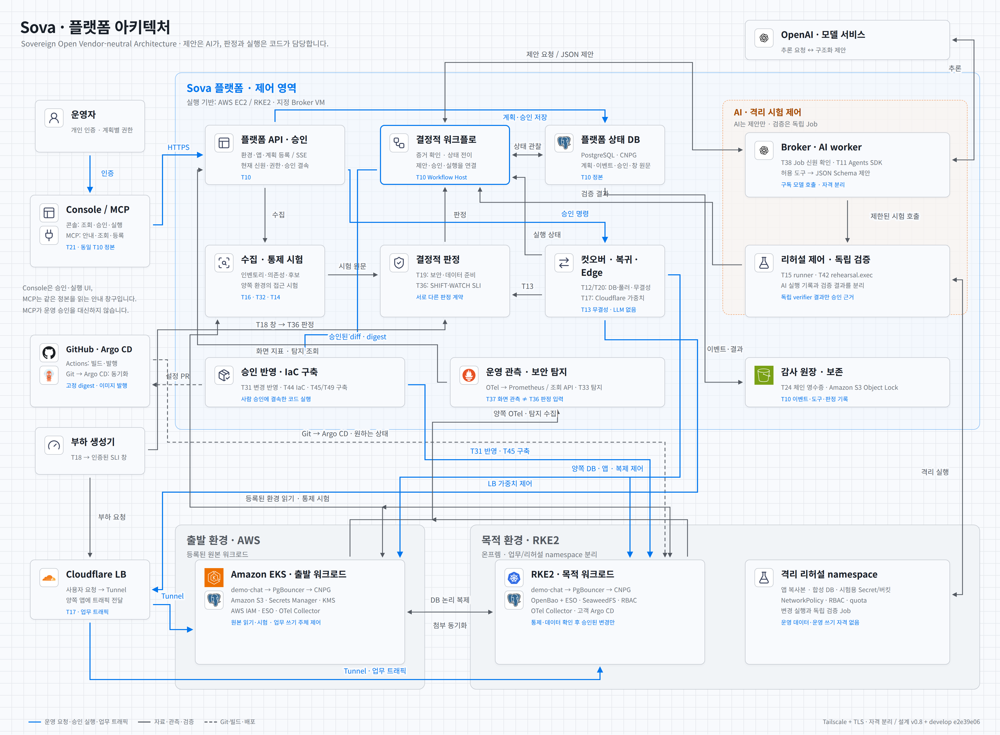

# SOVA · 클라우드 출구전략 플랫폼

**한국어** · [English](README.en.md) · [日本語](README.ja.md)

<p align="center"></p>

> **S**overeign(SoftBank) **O**pen **V**endor-neutral **A**rchitecture · SoftBank Hackathon 2026 본선 Team Bravo

**SOVA는 가동 중인 서비스를 AWS에서 온프레미스로 중단 없이 옮기는 플랫폼입니다. 옮긴 환경이 원본과 같은 수준으로 안전하고 정확하다는 사실을 검증 게이트로 확인한 뒤에만 전환합니다.**

금융 서비스는 규제와 비용, 계약 종료 같은 이유로 클라우드를 떠날 수 있어야 하고, 그 출구전략을 실제로 시험해 두어야 합니다. 그러나 기존 이전 도구는 데이터와 워크로드를 옮기는 작업만 보장하며, 옮긴 환경이 원본과 같은 보안 수준과 데이터 정확성을 갖추었는지는 보장하지 않습니다. SOVA에서는 AI가 격리된 리허설 환경에서 차이를 메우는 수정안을 **제안**하기만 하고, 판정과 전환은 결정적 코드와 사람의 승인이 담당합니다. 전환 뒤에 문제가 발생하면 그사이에 기록된 데이터까지 가지고 원래 환경으로 되돌아갑니다.

이 저장소에는 **플랫폼 코드, 인프라, 설계 문서와 작업 관리 기록**이 있습니다. 이전 대상인 데모 앱은 [`demo-chat`](https://github.com/Softbank-Hackathon-Finals/demo-chat) 저장소에 있습니다.

**▶ [인터랙티브 연출 열기](https://softbank-hackathon-finals.github.io/platform/presentation/sova-final-interactive.html)** · 플랫폼 구성과 7단계 이전 흐름을 클릭하며 따라가는 발표 연출입니다(GitHub Pages, 원본 [`docs/presentation/sova-final-interactive.html`](docs/presentation/sova-final-interactive.html)). 연출은 설계한 흐름을 보여 주며, 실환경에서 확인한 범위는 아래 "현재 상태와 한계"에 정리했습니다.

## 보안을 먼저 확인합니다

SOVA는 보안을 가장 먼저 내세우는 플랫폼입니다. **원본에서 거부되던 접근이 목적지에서도 같은 시험으로 거부된다는 사실을 확인하기 전에는 전환하지 않습니다.** AI는 격리된 환경에서 제안만 할 수 있고, 판정과 실행은 LLM을 사용하지 않는 결정적 코드와 사람의 승인이 맡습니다. 계층별 설계와 구현 상태(실환경 / 시험 / 설계)는 [SECURITY.md](SECURITY.md)에 정리했습니다.

| 계층 | 핵심 내용 | 상태 |
|---|---|---|
| 전략 | SoftBank가 2026-07-14에 발표한 **Patching as a Service**에서 착안해 "진단 → AI 수정 제안 → 격리 검증 → 승인 → 재진단" 순환을 이전 과정에 적용하고, 새로 공개된 취약점(Day-0)에 대응하는 방향으로 확장해 설계했습니다. Day-0라는 표현은 발표문이 아니라 팀의 해석입니다 | 설계, 일부 시험 |
| 보안 동등성 게이트 | 출발지와 목적지에 같은 통제 시험(통제 6개, 하위 시험 20개)을 실행하고, 결과가 다르거나 확인할 수 없으면 BLOCK합니다 | 실환경 일부(EKS와 RKE2에서 시험 3개를 실행했고, 의도한 BLOCK을 확인) |
| AI 에이전트 격리 | 도구 허용 목록, 턴당 함수 호출 1개, 600초 Job, broker 격리, 샌드박스 VM(`network=none`), 후보 코드를 실행하지 않는 빌드로 에이전트를 가둡니다. Harbor 반복 평가는 계획 단계입니다 | 실환경 일부 |
| 리허설 격리 | 리허설마다 무작위 네임스페이스를 만들고, PSA restricted와 기본 거부 정책을 적용하며, SA 토큰을 주지 않습니다 | 실환경 |
| 전환 안전 | epoch 펜싱과 의도 선기록을 사용하고, 상태를 확인할 수 없으면 SAFE_HOLD로 멈추며, Edge 가중치는 0·10·50·100%만 허용합니다 | Executor 실행은 실환경(데모 모드 1회), 거부와 복구 동작은 시험 |
| 탐지와 감사 | 탐지 결과를 OCSF로 정규화하고(GuardDuty는 실제 수집), 출발지와 목적지의 DB 접속·DDL·Kubernetes 권한 변경 감사 로그를 수집하며, 감사 기록을 S3 Object Lock COMPLIANCE 모드로 보존합니다 | 실환경 일부 |

보안 전략과 새로 공개된 취약점 대응(PHP2Shell 시나리오), 원본 대조 게이트, 통제 시험, 탐지 통합, 출발지·목적지 감사 로그 수집, Security Review는 이상무 님이 설계하고 구현했습니다([Security Governance v1](https://github.com/Softbank-Hackathon-Finals/security), [보안 문서](docs/security/README.md)). 계층별 담당은 [SECURITY.md의 계층 요약](SECURITY.md#계층-요약)에 있습니다. 아직 지키지 못한 부분은 [SECURITY.md의 알려진 한계](SECURITY.md#알려진-한계)에 함께 기록했습니다.

## 현재 상태와 한계

본선 기간(2026-11-06 ~ 11-08)에 실제 AWS EKS에서 온프렘 RKE2로 옮기는 해피패스를 실행했습니다. **잘못 통과한 판정은 한 번도 없었지만, 실환경에서는 GATE PASS에 도달하지 못했습니다.** 실환경에서 확인한 범위는 S1(수집, 분석, 첫 GATE 판정과 의도한 BLOCK)까지입니다. 최종 데모는 리허설과 게이트, 감시를 건너뛰는 데모 모드로 진행했으며, 그 데모에서 실제로 실행된 구성 요소는 컷오버 Executor입니다. 되돌리기와 Edge 부하 측정은 실환경에서 성립하지 않았습니다. 원인(빅뱅 통합, 대역 기반 시험, PASS에 도달할 수 없는 게이트 조건, 이미지와 설정의 비호환)과 다음 개선 방향은 [회고와 한계](docs/retrospective.md)에 정리했습니다.

## 콘솔

| 콘솔 | 만든 사람 | 형태 |
|---|---|---|
| [SOVA Console (데스크톱)](services/console/desktop/README.md) | 류지환 | Electron 앱입니다. 본인의 AWS SSO로 SOVA MCP에 연결하고, 안내자(에이전트)와 함께 상태를 확인하며 등록 초안을 작성합니다. 사용 안내가 포함되어 있습니다 |
| [Sova 이전 운영 콘솔](services/console/README.md) | 이상무 | 플랫폼 호스트의 T10 API에 연결되는 웹 운영 화면입니다. 보안 통제 보고서, 탐지, 관측, 복귀, 감사 기록을 근거별로 나누어 보여 줍니다 |

## 담당 영역

보안 계층별 담당은 [SECURITY.md](SECURITY.md#계층-요약)에, 작업별 담당 전체는 [`docs/tasks.md`](docs/tasks.md)와 [프로젝트 보드](https://github.com/orgs/Softbank-Hackathon-Finals/projects/2)에 있습니다. 보안 계층과 콘솔 밖에서 담당을 따로 적어 두는 영역은 다음과 같습니다.

| 영역 | 담당 | 내용 |
|---|---|---|
| 목적지 구축 | 이상무(T44), 전동훈(T45) | 두 사람이 범위를 나눠 함께 만들었습니다. [목적지 IaC API](docs/adr/0032-destination-iac-api.md)(T44)는 모듈 카탈로그, Git에 둔 원하는 상태, 계획 API, 네트워크 경로 선언, 고객 클러스터의 Argo CD를 맡습니다. [목적지 처음 구축 실행기](docs/adr/0033-destination-bootstrap-executor.md)(T45)는 빈 클러스터에서 목적지를 처음 세우는 단계 스택과 실행을 맡으며, 목적지 Argo CD는 T44 설치를 함께 씁니다. 류지환 님이 tailnet 정책 GitOps, 사람의 API 접근, 노드 파일 API를 더해 T44를 넓혔습니다 |
| 관측 | 이상무 | 판정용 관측 계약과 SHIFT·WATCH 판정 규칙(T36), OpenTelemetry Collector로 출발지와 목적지의 지표를 플랫폼 지표 저장소에 모으는 수집(T37)입니다. 계약은 [`docs/observability/`](docs/observability/README.md)에 있습니다 |
| 백업과 복원 | 이상무 | 출발지와 목적지의 CNPG 백업·복원입니다(T35). 별도 클러스터로 복원해 읽어 대조하는 절차와 WAL 누락 거부를 로컬 kind에서 시험했습니다 |
| 데모 앱 | 이상무 | 이전 대상인 [`demo-chat`](https://github.com/Softbank-Hackathon-Finals/demo-chat)의 v0·v1입니다(T4·T22) |
| 병합 자동화 | 이상무(T41은 류지환과 함께) | develop Merge Queue와 승인 없는 CI 병합을 도입했습니다(T40·T41, [ADR-0017](docs/adr/0017-develop-merge-queue.md)). 11/7에 Merge Queue를 규칙에서 제거해 지금은 쓰지 않습니다 |
| 개인 프로토타입 | 이상무 | [`sova-test`](https://github.com/Softbank-Hackathon-Finals/sova-test)는 이상무 님의 개인 개발 프로토타입과 통합·시연 환경을 보존하는 저장소입니다 |

## 아키텍처

**간략 구성도**에는 기능 묶음 9개와 그 사이의 주요 흐름만 표시했습니다.

<picture>
  <source media="(prefers-color-scheme: dark)" srcset="docs/assets/architecture-overview-dark.png">
  
</picture>

운영팀이 이전을 시작하면 플랫폼은 수집 → 분석 → AI 제안 → 리허설 → **원본 대조 게이트** → **사람 승인** → 전환 → 감시와 되돌리기 순서로 진행합니다. 게이트를 통과하고 승인을 받은 경우에만 전환이 시작됩니다. 원본은 [설계 문서](docs/design.html) 7.1절입니다.

**상세 구성도**에는 구성 요소 20개와 작업 번호, 명령과 자료, 배포 경로를 구분해 표시했습니다.

<picture>
  <source media="(prefers-color-scheme: dark)" srcset="docs/assets/architecture-detail-dark.png">
  
</picture>

두 그림은 develop `e2e39e06`과 설계 문서 v0.8을 기준으로 그린 논리 구성도이며, 화살표는 이전 단계의 순서를 나타내지 않습니다. 워크로드 기능별 대체(Cognito → Keycloak, SQS와 Lambda → ElasticMQ 등)와 VPC, 접속, 자격 발급의 상세 내용은 생략했습니다. 어느 계정과 VPC, 머신에 무엇이 배치되는지는 설계 문서 7.2절에서 설명합니다.

## 구성

| 구성 요소 | 설명 | 성격 |
|---|---|---|
| 콘솔과 API | 환경 등록, 진행 상황 표시, 승인, 결과 조회를 제공합니다 | 결정적 |
| 상태 머신 | 단계와 전이 조건을 고정하고 상태를 저장하며, 조건을 만족하지 않으면 다음 단계로 넘어가지 않습니다 | 결정적 |
| 수집기 | 출발지와 목적지의 설정을 읽기 전용으로 수집합니다 | 결정적 |
| 에이전트 워커 | 의존성 분류, 번역과 코드 수정 제안서(JSON Schema), 실패 원인 추정, 승인용 요약을 작성하며 실행 권한은 없습니다 | AI |
| 리허설 러너와 도구 계층 | 목적지에 격리 네임스페이스를 만들고, 검증 Job으로 결과를 채점한 뒤 네임스페이스를 삭제합니다 | 결정적(내부에서 AI가 시도) |
| 통제 시험기와 원본 대조 게이트 | 6개 보안 통제를 원본과 대상에서 똑같이 시험하고, 결과가 다르면 전환을 막으며 LLM을 사용하지 않습니다 | 결정적 |
| Cutover Executor | 쓰기를 몇 초 동안만 멈추는 전환 구간을 실행하고, 무결성을 비교하고, 필요하면 되돌리며 LLM을 사용하지 않습니다 | 결정적 |
| Edge 제어 | Cloudflare LB 가중치로 트래픽을 10 → 50 → 100%로 옮기고, 문제가 생기면 즉시 되돌립니다 | 결정적 |
| 감사 로그 | 단계 전이, 판정, 승인, 에이전트 입출력, 차단 기록을 지울 수 없게 보존합니다(S3 Object Lock) | 결정적 |

## 저장소 구조

```
platform/
├── infra/                      # 설계 문서 8.8절 구조를 따르는 인프라
│   ├── modules/                # 기능 계약과 환경별 구현 (network · cluster · node · database · secret · object_store · edge · ci_identity)
│   └── envs/                   # 환경별 적용 단위
├── docs/
│   ├── design.html             # 설계 문서 최신본 (브라우저로 엽니다)
│   ├── design-history/         # 이전 설계 문서 버전과 버전 이력
│   ├── tasks.md                # 단계별 작업과 역할 분담 (이슈와 자동 동기화)
│   ├── adr/                    # 결정 기록 (0000-template.md)
│   └── assets/                 # README 그림
├── services/                   # 플랫폼 서비스 22개
├── scripts/
│   ├── sync_tasks.py           # tasks.md와 이슈, 보드 동기화
│   └── design-bump.sh          # 설계 문서 버전 올리기
├── .agents/skills/todo-task/   # 작업 진행 스킬 (.claude/skills/todo-task는 링크)
├── .github/workflows/          # CI, 이미지 발행, 작업 동기화
├── AGENTS.md                   # 에이전트 작업 안내 (CLAUDE.md가 불러옵니다)
├── SECURITY.md                 # 계층별 보안 정리
└── README.md
```

플랫폼 코드는 `services/` 아래에 서비스별 폴더와 README로 나뉘어 있습니다. 콘솔, MCP, 상태 머신, 에이전트 워커, 통제 시험기, 게이트, Executor, Edge 제어, 감사 로그, 관측 등 22개 서비스가 있습니다.

## demo-chat과의 관계

플랫폼은 `demo-chat`을 **고객의 저장소**처럼 다루기 때문에 저장소를 분리했습니다.

| 대상 | 처리 방식 |
|---|---|
| 앱 분석 | 저장소 URL과 경로로 앱을 등록하고, 코드와 실제 배포 상태를 대조합니다(T16) |
| 수정 반영 | 리허설을 통과하고 승인된 diff만 앱 저장소의 브랜치에 커밋합니다(T31). 토큰 권한은 읽기와 브랜치 쓰기로 좁힙니다 |
| 이미지 | 출발지와 목적지는 같은 digest의 앱 이미지를 받습니다(T7). 수정안을 반영한 후보 이미지는 GitHub를 거치지 않고 플랫폼이 빌드합니다([ADR-0052](docs/adr/0052-platform-candidate-build-without-github.md)) |

앱이 지켜야 하는 조건(멱등 키, 재접속, 쓰기 차단 스위치 등)은 설계 문서 8.10절과 `demo-chat` 저장소의 `AGENTS.md`에 있습니다.

## 워크플로

| 워크플로 | 역할 |
|---|---|
| `ci.yml` | PR과 main·develop push마다 필수 검사 3개를 실행합니다. `secrets`는 PR 제목 형식과 gitleaks, 증빙 형식을 검사하고, `infra`는 actionlint, hadolint, Terraform, Trivy config를 검사하며, `platform`은 `pyproject.toml`, `package.json`, `go.mod`를 찾아 언어별 lint와 test, Trivy fs를 실행합니다 |
| `publish-*.yml` | 서비스 이미지를 스캔하고 SBOM과 provenance를 붙여 발행한 뒤, digest를 고정하는 PR을 만듭니다 |
| `sync-tasks.yml` | `tasks.md`가 병합되면 계획을 이슈에 반영하고, 이슈의 체크와 담당자가 바뀌면 보드를 옮기고 `tasks.md`를 봇 PR로 수정합니다 |

## 팀원 작업 방법

1. [프로젝트 보드](https://github.com/orgs/Softbank-Hackathon-Finals/projects/2)나 [`docs/tasks.md`](docs/tasks.md)에서 맡은 작업을 찾습니다. 진행 상황은 보드(이슈)를 기준으로 판단합니다.
2. `develop`에서 `feature/T번호-설명` 브랜치를 만들고 `develop`으로 PR을 올립니다. 대상 브랜치의 ruleset과 필수 CI, 리뷰 요건을 충족한 뒤 merge commit으로 병합하며, GitHub가 조건을 확인하도록 auto-merge를 예약할 수도 있습니다. `main`에는 release 또는 hotfix 브랜치로 반영합니다. 자세한 순서는 [Gitflow 순서](docs/development.md)와 [리뷰 안내](docs/review-playbook.md)에 있습니다.
3. 커밋 메시지와 PR 제목 앞에는 `[T번호]`를 붙입니다. 끝낸 할 일은 **이슈에서** 체크하며, 보드 이동과 tasks.md 갱신은 자동으로 처리됩니다. 계획(완료 기준, 할 일, 새 작업)을 바꿀 때는 `tasks.md`를 수정해 PR로 올립니다.
4. Claude Code에서는 `/todo-task`, Codex에서는 `$todo-task` 스킬로 이 과정을 진행할 수 있습니다.

저장소 설정과 CI, 작업 흐름, 이슈 봇에 관한 자세한 설명은 노션 [WorkGuide](https://app.notion.com/p/40c8bee9ada4802fb712d2df18eeb6e0)(팀원 전용)에 있습니다.

## 문서

- [보안](SECURITY.md): 계층별 보안 설계와 구현 상태, 알려진 한계, 취약점 신고 방법
- [회고와 한계](docs/retrospective.md): 본선 해피패스에서 드러난 문제와 남은 한계
- [계약 목차](docs/contracts/README.md): 보안, 관측, 무결성, 승인 계약의 원본과 생산자·소비자 연결
- [설계 문서](docs/design.html): 브라우저로 열어 보는 설계 문서 원본(그림은 SVG로 포함)
- [설계 문서 버전 이력](docs/design-history/README.md): 버전을 올리는 기준과 이전 버전 사본
- [해야 할 일](docs/tasks.md): 단계별 작업과 역할 분담
- [결정 기록과 실측 근거](docs/adr/README.md): 설계별 ADR과 측정 자료의 위치. 새 결정은 [`0000-template.md`](docs/adr/0000-template.md) 형식으로 작성합니다
- [보안 설계 문서](docs/security/README.md): 이상무 님이 작성한 보안 전략과 설계(원본은 노션)
- [에이전트 작업 안내](AGENTS.md): 작업 규칙, 설계 원칙, 보안 규칙, 검증 명령

## 작업 현황

진행 상황은 [Team Bravo Finals](https://github.com/orgs/Softbank-Hackathon-Finals/projects/2) 보드와 이 저장소의 이슈에서 확인합니다. 칸반 조회와 작업 시작, 완료 체크에는 [프로젝트 보드 안내](docs/project-board.md)와 루트 Makefile을 사용합니다.

본인 PR에 리뷰가 도착했는지는 `python3 scripts/review_watch.py`로 확인합니다. `--watch`는 60초 이상의 간격으로 계속 조회하고, `--notify`는 선택적으로 macOS 알림을 보내며, `--install-git-alias`는 이 저장소에 `git review-watch` 명령을 설정합니다. 첫 조회에서는 기존 리뷰를 기준선으로 기록하며, 알림은 승인이나 병합 자격을 판정하지 않습니다. 사용법과 private cursor는 [리뷰 안내](docs/review-playbook.md#5-git-cli에서-리뷰-도착-확인)에, 실제 검토 절차는 [PR 리뷰 스킬](.agents/skills/pr-review/SKILL.md)에 있습니다.
