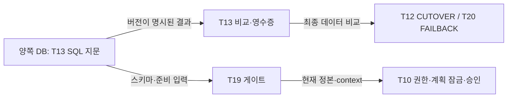

# ADR-0013: 무결성 지문의 생산 위치와 소비 경계

* **상태:** 제안됨 — 11/4 Slack 합의를 저장소에 옮긴 기록. 구현·계약 시험의 완료 선언이 아니다.
* **날짜:** 2026-11-04
* **관련:** T13 #23, T12 #22, T19 #29, T20 #30, T29 #10, 설계 §8.6

## 1. 배경과 문제

T13의 DB 내부 SQL 지문 초안과 T12 PR #134의 Executor 내부 비교는 계산 위치뿐 아니라 직렬화 의미도 다르다. 같은 `compare()` 인터페이스를 사용한다고 같은 `hash_rule`로 간주할 수 없다. 두 구현을 각 소비자가 따로 발전시키면 정상 데이터의 판정과 쓰기 정지 시간이 달라질 수 있다.

태현님의 [비교·스키마 논의](https://app.notion.com/p/40d8bee9ada4814881e7e74bac7f9908)는 로컬 성능 실험과 미확정 값을 담는다. 이 ADR은 합의된 생산·소비 경계를 기록하고, 아래에 구현 검토 기준을 옮긴다. SQL 본문은 T13 구현에 한 번만 두고 소비자는 이를 재사용한다. Notion은 논의·실험 원문이며 이 ADR의 규칙과 미확정 항목을 혼합해 런타임 상수로 사용하지 않는다.

## 2. 고려한 선택

| 선택 | 이점 | 제약 |
|---|---|---|
| Executor가 모든 행을 읽어 지문 계산 | 한 프로세스의 직렬화 규칙으로 비교 가능 | 네트워크 전송량과 정지 시간이 데이터 크기에 영향을 받음 |
| 각 DB 안에서 SQL로 지문 계산 | 네트워크에는 지문·행 수 등 비교 결과만 전달 | SQL의 타입 표현·정렬 설정·지원 버전과 의미를 명시해야 함 |

로컬 제한 네트워크 실험은 계산 위치를 선택하는 근거다. 실제 Tailscale·TLS 경로의 컷오버 정지 시간이나 대표 데이터에서의 성능 충족을 증명하지 않는다.

## 3. 결정

1. **T13이 DB 내부 SQL 지문을 생산한다.** T12는 기존 `compare(src, dst, tables)`·영수증·실행 단계에 연결한다. T19는 스키마·준비 판정 입력을, T20은 방향을 바꾼 무결성 비교를 소비한다. 각 소비자가 SQL과 직렬화를 재구현하지 않는다.
2. **DB 내부 방식에는 별도 `hash_rule`을 부여한다.** 구체적인 값·지원 타입·직렬화와 계약 사례는 T13 구현 PR에서 함께 고정한다. 숫자와 JSON 표현 차이가 있는 기존 Python 방식과 동일한 버전 이름을 공유하지 않는다.
3. **데이터 지문과 스키마 판정을 구분한다.** 데이터 MATCH만으로 스키마 준비 또는 컷오버를 허용하지 않는다. DB/컬럼 collation의 제공자·로케일·규칙·determinism·버전 대조를 유지한다. 미지원 타입, 제한 초과, 설정 불명은 통과로 치환하지 않는다.
4. 시퀀스는 양쪽 실제 최대 ID와 `is_called`를 반영한 다음 발급값을 근거로 올리기만 한다. 최종 계산·범위·실제 재조회는 구현 계약에서 시험한다. 논의의 여유값을 새 확정 상수로 옮기지 않는다.
5. 최종 무결성 비교는 설계 §8.6의 쓰기 차단·펜싱·barrier 뒤에 수행한다. 사전 T19 준비 판정과 이 최종 비교는 서로를 대체하지 않는다. 전체 쓰기 정지 시간은 설계의 첫 제한부터 마지막 업무 ACK까지 측정한다.

## 4. T13 구현 검토 기준

2026-11-04 00:22 KST 갱신한 Notion 원문에서 옮긴 규칙이다. 아래의 표현·정렬 의미를 T13 구현 PR의 공통 계약 시험으로 고정한다. 이 문서가 병합돼도 SQL 구현·실환경 인수가 끝났다는 뜻은 아니다.

| 경계 | 구현할 규칙 / 판정 |
|---|---|
| 대상·읽기 시점 | 현재 데모의 `messages`, `attachments`. 쓰기 차단과 barrier 뒤 양쪽을 읽기 전용 REPEATABLE READ로 비교한다. 첨부 원본 바이트의 비교는 이 DB 지문의 범위가 아니다. |
| 세션 표현 | `TimeZone=UTC`, `DateStyle=ISO, YMD`, `IntervalStyle=postgres`, `extra_float_digits=1`, `bytea_output=hex`로 고정한다. 양쪽 PostgreSQL 메이저 버전이 같은 지원 범위를 전제로 하고, 다른 버전을 검증 없이 호환으로 선언하지 않는다. |
| 행·표 지문 | DB 카탈로그에서 컬럼·PK를 읽는다. 이름순 컬럼의 `::text`를 `jsonb_build_array`로 묶어 NULL·값 경계를 보존한다. UTF-8 행 표현의 SHA-256을 PK 순으로 집계해 표 지문을 만든다. 문자 PK와 스키마 지문 행 순서는 `COLLATE "C"`로 고정한다. 빈 표·복합 PK 등 세부 경계는 같은 계약 사례로 검증한다. |
| 두 판정 | 행 수·PK·내용의 데이터 판정과 스키마 판정을 분리한다. 둘 다 MATCH일 때만 다음 전환 단계로 진행한다. 미지원 타입·쿼리 제한 초과·정렬 버전 불일치·불명은 통과로 바꾸지 않는다. |
| 스키마 | 컬럼 이름·타입·NOT NULL·identity·제약과 실제 정렬 의미를 비교한다. DB 기본 인코딩·제공자·로케일·규칙, 컬럼의 collation, determinism·버전 검사도 유지한다. 단순 OID·이름이나 데이터 MATCH로 대체하지 않는다. |
| 숫자·JSON | SQL 초안은 `numeric 1.5/1.50`, `jsonb 1/1.0`을 다르게 볼 수 있다. 기존 Python 비교기는 같은 수로 정규화한다. 해당 타입 도입 시 의미를 확정하고 별도 `hash_rule`로 식별한다. 기존 규칙의 별칭으로 배포하지 않는다. |
| 시퀀스·영수증 | 양쪽 최대 ID와 `is_called` 반영 다음 발급값으로 수신 측을 올리기만 한다. 영수증은 설계 §8.6 형식·기존 저장 경로를 쓰며 목적지 쓰기 전에 저장한다. 계산값·범위·재조회 시험은 T13/T12 구현에서 함께 확인한다. |

쓰기 정지 5초, 쿼리 제한 3초, 시퀀스 여유 1000은 Notion의 제안·측정 조건이다. 여기서 새 확정 상수로 만들지 않는다. 실제 적용값과 최종 `hash_rule` 식별자는 구현·통합 PR에서 담당자가 고정한다. T19 호출 포트도 현재 구현과 맞춰야 한다.

원문 실험에서 DB 내부 계산은 제한 없는 연결 0.6초, 가정한 100/20Mbps·RTT 30ms 조건 1.3초였고, 기존 Executor 계산은 각각 4.3/61.6/132.3초였다. 목적지 전송량은 약 2KB 대 195MB였다. **같은 Mac의 PostgreSQL 18.4 컨테이너, TLS 없음, 202MB 표본의 로컬 실험**이다. 시간은 양쪽을 순서대로 읽은 합계 중앙값(제한 없음 3회, 제한 조건 2회)이며 collation 보강 전 수치다. 실제 Tailscale 경로·전체 쓰기 정지 시간·최신 SQL의 성능 보장으로 쓰지 않는다. 왕복 횟수가 병목이라는 설명도 원문의 미검증 추정이다.

## 5. 통합 확인과 남은 범위

- T13 구현 PR에서 NULL/타입 경계, 숫자·JSON 표현, PK 순서, collation 변경, 지원하지 않는 설정을 같은 계약 사례로 고정한다. 인터페이스 재사용만 확인하고 판정 의미의 일치를 선언하지 않는다.
- T12 소비 검증은 등록된 규칙 버전, 기존 collation 검사, 불명·timeout 처리, 영수증 저장 위치와 방향을 확인한다. 기존 비교기를 대체할 때는 모든 소비자를 옮긴 뒤 사용되지 않는 경로를 제거한다.
- 실제 TLS 경로에서 준비 완료 → 쓰기 차단 → 비교 → 재접속·업무 ACK까지의 시간을 측정해야 한다. 로컬 SQL 시간만 합산한 값을 전체 정지 시간으로 보고하지 않는다.
- 11/4 실제 DB의 collation 카탈로그 관측은 [PR #134의 공개 증빙](https://github.com/Softbank-Hackathon-Finals/platform/blob/8110dbbf8bc7588d67c66c2ed027035276f17727/docs/evidence/t12-integration-2026-11-03/README.md)에 있다. 해당 관측은 SQL 지문 구현의 배포나 전체 컷오버 성공을 뜻하지 않는다.

## 근거

- [T13 계산 위치·계약 합의 스레드](https://softbankhackathon2026.slack.com/archives/C0CDEFEB83U/p1793717529168819), [T12 소비·실제 설정 확인 답변](https://softbankhackathon2026.slack.com/archives/C0CDEFEB83U/p1793718889585929)
- [태현님의 스키마·지문 정렬 업데이트](https://softbankhackathon2026.slack.com/archives/C0CDEFEB83U/p1793718669465929), [T13 논의 원문](https://app.notion.com/p/40d8bee9ada4814881e7e74bac7f9908) — 2026-11-04 00:22 KST 갱신 확인
- [T12 소비 구현 PR #134](https://github.com/Softbank-Hackathon-Finals/platform/pull/134), [T19 구현 PR #141](https://github.com/Softbank-Hackathon-Finals/platform/pull/141). 병합·배포 상태는 각 PR과 증빙에서 확인한다.
