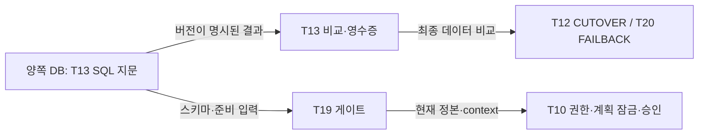

# ADR-0013: 무결성 지문의 생산 위치와 소비 경계

* **상태:** 제안됨 — 11/4 Slack 합의를 저장소에 옮긴 기록. 구현·계약 시험의 완료 선언이 아니다.
* **날짜:** 2026-11-04
* **관련:** T13 #23, T12 #22, T19 #29, T20 #30, T29 #10, 설계 §8.6

## 1. 배경과 문제

T13의 DB 내부 SQL 지문 초안과 T12 PR #134의 Executor 내부 비교는 계산 위치뿐 아니라 직렬화 의미도 다르다. 같은 `compare()` 인터페이스를 사용한다고 같은 `hash_rule`로 간주할 수 없다. 두 구현을 각 소비자가 따로 발전시키면 정상 데이터의 판정과 쓰기 정지 시간이 달라질 수 있다.

태현님의 [비교·스키마 논의](https://app.notion.com/p/40d8bee9ada4814881e7e74bac7f9908)는 로컬 성능 실험과 미확정 값을 담는다. 이 ADR은 합의된 생산·소비 경계를 기록하고, 구체적인 SQL·직렬화 규칙과 시험 사례는 T13 구현 PR에서 함께 검토한다. 논의 문서를 또 하나의 런타임 계약으로 복제하지 않는다.

## 2. 고려한 선택

| 선택 | 이점 | 제약 |
|---|---|---|
| Executor가 모든 행을 읽어 지문 계산 | 한 프로세스의 직렬화 규칙으로 비교 가능 | 네트워크 전송량과 정지 시간이 데이터 크기에 영향을 받음 |
| 각 DB 안에서 SQL로 지문 계산 | 네트워크에는 지문·행 수 등 비교 결과만 전달 | SQL의 타입 표현·정렬 설정·지원 버전과 의미를 명시해야 함 |

로컬 제한 네트워크 실험은 계산 위치를 선택하는 근거다. 실제 Tailscale·TLS 경로의 컷오버 정지 시간이나 대표 데이터에서의 성능 충족을 증명하지 않는다.

## 3. 결정

1. **T13이 DB 내부 SQL 지문을 생산한다.** T12는 기존 `compare(src, dst, tables)`·영수증·실행 단계에 연결한다. T19는 스키마·준비 판정 입력을, T20은 방향을 바꾼 무결성 비교를 소비한다. 각 소비자가 SQL과 직렬화를 재구현하지 않는다.
2. **DB 내부 방식에는 별도 `hash_rule`을 부여한다.** 구체적인 값·지원 타입·직렬화와 계약 사례는 T13 구현 PR에서 함께 고정한다. 숫자와 JSON 표현 차이가 있는 기존 Python 방식과 동일한 버전 이름을 공유하지 않는다.
3. **데이터 지문과 스키마 판정을 구분한다.** 데이터 MATCH만으로 스키마 준비 또는 컷오버를 허용하지 않는다. DB/컬럼 collation의 제공자·로케일·규칙·determinism·버전 대조를 유지한다. 미지원 타입, 제한 초과, 설정 불명은 통과로 치환하지 않는다.
4. 시퀀스는 양쪽 실제 최대 ID와 `is_called`를 반영한 다음 발급값을 근거로 올리기만 한다. 최종 계산·범위·실제 재조회는 구현 계약에서 시험한다. 논의의 여유값을 새 확정 상수로 옮기지 않는다.
5. 최종 무결성 비교는 설계 §8.6의 쓰기 차단·펜싱·barrier 뒤에 수행한다. 사전 T19 준비 판정과 이 최종 비교는 서로를 대체하지 않는다. 전체 쓰기 정지 시간은 설계의 첫 제한부터 마지막 업무 ACK까지 측정한다.

## 4. 통합 확인과 남은 범위

- T13 구현 PR에서 NULL/타입 경계, 숫자·JSON 표현, PK 순서, collation 변경, 지원하지 않는 설정을 같은 계약 사례로 고정한다. 인터페이스 재사용만 확인하고 판정 의미의 일치를 선언하지 않는다.
- T12 소비 검증은 등록된 규칙 버전, 기존 collation 검사, 불명·timeout 처리, 영수증 저장 위치와 방향을 확인한다. 기존 비교기를 대체할 때는 모든 소비자를 옮긴 뒤 사용되지 않는 경로를 제거한다.
- 실제 TLS 경로에서 준비 완료 → 쓰기 차단 → 비교 → 재접속·업무 ACK까지의 시간을 측정해야 한다. 로컬 SQL 시간만 합산한 값을 전체 정지 시간으로 보고하지 않는다.
- 11/4 실제 DB의 collation 카탈로그 관측은 [PR #134의 공개 증빙](https://github.com/Softbank-Hackathon-Finals/platform/blob/8110dbbf8bc7588d67c66c2ed027035276f17727/docs/evidence/t12-integration-2026-11-03/README.md)에 있다. 해당 관측은 SQL 지문 구현의 배포나 전체 컷오버 성공을 뜻하지 않는다.

## 근거

- [T13 계산 위치·계약 합의 스레드](https://softbankhackathon2026.slack.com/archives/C0CDEFEB83U/p1793717529168819), [T12 소비·실제 설정 확인 답변](https://softbankhackathon2026.slack.com/archives/C0CDEFEB83U/p1793718889585929)
- [태현님의 스키마·지문 정렬 업데이트](https://softbankhackathon2026.slack.com/archives/C0CDEFEB83U/p1793718669465929), [T13 논의 원문](https://app.notion.com/p/40d8bee9ada4814881e7e74bac7f9908) — 2026-11-04 00:22 KST 갱신 확인
- [T12 소비 구현 PR #134](https://github.com/Softbank-Hackathon-Finals/platform/pull/134), [T19 구현 PR #141](https://github.com/Softbank-Hackathon-Finals/platform/pull/141). 병합·배포 상태는 각 PR과 증빙에서 확인한다.
