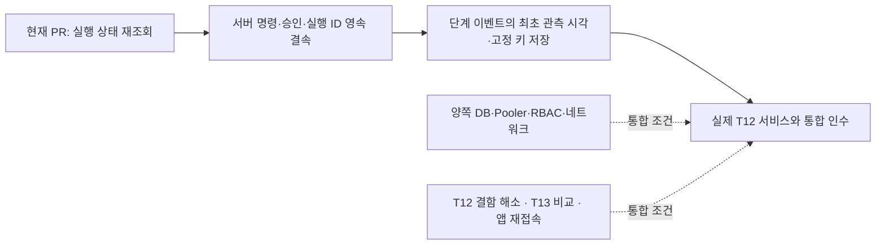

# T10 → T12 실행 상태 재조회

T10 #19의 **읽기 전용 소비 어댑터**다. 공개 T12 #116 `cccddc0`의 `Execution.view()`와 `GET /v1/cutovers/{id}`, `GET /v1/cutovers?plan_id=&epoch=`를 기준으로 한다. [설계 §8.6](../design.html#s8-6)의 응답 유실 후 원격 상태 대조를 작은 단위로 구현한다. 기존 계획·SSE 저장소에 import해서 쓰며 별도 서비스·DB·polling framework를 추가하지 않는다.

## 해결한 문제

호출 응답이 사라졌다고 새 epoch로 다시 실행하면 앞선 작업과 겹칠 수 있다. 조회 404나 빈 목록도 ‘실행되지 않았다’는 증거가 아니다. 이 어댑터는 한 번의 GET으로 식별자를 대조하고, 판정할 수 없으면 `UNKNOWN`을 반환한다. POST, 자동 재시도, lease 해제, 상태 전이는 제공하지 않는다.

| 관측 | 반환 | 호출자의 다음 행동 |
|---|---|---|
| 실행 ID·계획·epoch 일치, 정상 형식 | `OBSERVED` + 허용 필드 snapshot | 원격 보고로 보존하고 별도 승인/완료 조건과 대조 |
| 계획·epoch 조회에서 정확히 1개 | 해당 실행의 식별자까지 검증 | 신뢰된 명령 기록과 대조한 뒤 실행 ID를 영속 결속 |
| 빈 목록 / 404 | `UNKNOWN` | 원격 미실행으로 단정하거나 새 명령을 만들지 않음 |
| 복수 실행 / ID·계획·epoch 불일치 | `UNKNOWN` | 소유·결속 문제를 확인 |
| timeout / 5xx / 인증 거부 / redirect | `UNKNOWN` | 기존 hold와 명령을 유지하고 운영 경로 확인 |
| 이전 관측보다 짧거나 바뀐 단계 이력, 시간·commit 회귀 | `UNKNOWN` | 과거 snapshot을 덮어쓰지 않음 |
| 원격 `SAFE_HOLD` | `OBSERVED`, `remote_status=SAFE_HOLD` | 사람이 해제하는 계약 유지 |
| 원격 `DONE` | `OBSERVED`, `remote_status=DONE` | T10 `DONE`으로 자동 전이하지 않음 |

`UNKNOWN`은 T12가 제공하는 실행 상태와 구별되는 **조회 결과**다. `OBSERVED`도 안전·승인·무결성 판정이 아니다. 특히 현재 T12 리뷰의 설정 영속화·소유권 결함이 해소됐다는 뜻이 아니다.

## 호출 경계

```python
from bravo_platform_events.executor import ExecutorReader, ExpectedExecution

# 아래 값은 서버의 명령/환경 기록에서 가져온다. 외부 HTTP 입력을 그대로 쓰지 않는다.
expected = ExpectedExecution("plan-demo", 7, "aaaaaaaa-aaaa-4aaa-8aaa-abcdefabcdef")
with ExecutorReader("https://executor.example.invalid") as reader:
    observation = reader.read(expected)
```

- `ExpectedExecution` 생성 자체는 인증이나 승인 증명이 아니다. 호스트가 principal/tenant와 계획 접근을 먼저 검증해야 한다. 현재 호스트의 계획 조회 인증 경로에 새 쓰기 API를 붙이지 않는다.
- 원격 접속 origin은 서버 설정으로 고정하고 HTTPS 인증서 검증을 사용한다. URL의 사용자 정보·query·fragment·path를 거부하고 환경 proxy를 상속하지 않는다. HTTP는 시험용 literal loopback만 허용한다. `transport` 주입은 신뢰된 테스트/호스트 구성의 경계이며 별도 transport가 TLS를 끄지 않도록 호스트가 책임진다.
- 선택적 Bearer 자격은 메모리 인자로만 받는다. 현재 T12 API가 서비스 인증을 구현했다는 뜻은 아니다. 실제 배포에서는 전용 인증·네트워크 경계를 먼저 갖춰야 한다.
- 응답은 256 KiB, 단계 목록은 256개, 단일 socket 작업은 기본 5초로 제한한다. 스트림 처리 중에도 경과 시간을 확인한다. redirect, 압축 응답, 중복 JSON 키를 거부한다. socket timeout은 전체 분산 작업의 취소나 deadline 보장이 아니다.
- snapshot에는 실행 ID, 계획, epoch, 원격 상태, commit 여부, 단계 이름·상태·시간, 실행 전체의 생성·갱신 시각만 담는다. 원시 `result`, 단계 `detail`, 예외 원문은 반환하지 않는다.
- `previous`를 주면 동일 실행의 append-only 단계 이력과 시간·commit 진행을 확인한다. `SAFE_HOLD` 또는 종료 상태를 임의로 다시 열지 않는다. 의도한 수동 해제는 별도 인수 절차로 처리한다.

## 다음 연결 순서



현재 T10은 계획 등록·COLLECT→ANALYZE 및 조회·SSE 저장 계약을 가진다. 승인 소비 처리기는 아직 없다. 후속 쓰기 경로는 승인자의 권한, tenant, 현재 계획·게이트·대상·명령·만료, 실제 DB 쌍과 구성 revision을 대조하고 명령을 영속 저장한 뒤 호출해야 한다.

실행 ID가 없는 복구 조회는 단일 결과를 찾는 데까지다. T12 GET은 원래 요청 digest·환경 참조를 돌려주지 않으므로 응답만으로 승인한 실제 DB 쌍을 증명할 수 없다. 서버의 불변 명령 기록/Executor 구성과의 결속은 후속 작업이다. 서비스가 반환하는 `created_at`/`updated_at`을 단계별 발생 시각으로 사용하지 않는다. durable projection을 추가할 때 실행+단계 ordinal의 고정 키와 최초 관측 시각을 원자 저장해야 하며, 매 poll마다 새 SSE 이벤트를 만들면 안 된다.

## 검증과 남은 범위

`services/platform-events/tests/test_executor.py`는 모의 HTTP 응답과 실제 loopback TCP 서버에서 상태·동일성·응답 유실·부정 경로·이력 회귀·redirect를 시험한다. 기존 SQLite/PostgreSQL 회귀도 함께 실행한다. AWS 결과는 [증빙](../evidence/t10-executor-read-2026-11-03/README.md)에 실행 위치와 한계를 구분해 기록한다.

이 PR은 실제 Executor 배포, 사용자 로그인, 승인 소비, DB 역할 적용, SSE 영속 projection, 실제 컷오버를 완료하지 않는다. T7·T12의 진행 중인 수정 파일과 공유 클라우드 자원을 변경하지 않는다. 전체 T10 #19는 열린 상태로 유지한다.
