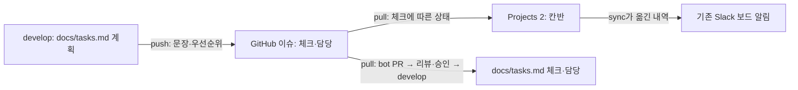

# 프로젝트 칸반과 로컬 작업

기준 보드는 [Team Bravo Finals · View 2](https://github.com/orgs/Softbank-Hackathon-Finals/projects/2/views/2)다. 저장소 `platform`의 T번호 이슈를 카드로 사용한다. PR은 해당 이슈를 `Refs #번호`로 연결한다. 일부 구현 PR이 머지됐다고 작업 전체를 닫지 않는다.



`scripts/sync_tasks.py`가 공통 로직이고 `.github/workflows/sync-tasks.yml`이 이벤트를 연결한다. `develop`의 계획 또는 스크립트 변경은 `push`, 이슈 편집·닫기·재열기·담당 변경은 `pull`을 실행한다. 봇은 `bot/sync-tasks → develop` PR을 만들고 필수 CI와 팀원 리뷰 승인 후 merge commit으로 합친다. 봇은 자동 머지를 예약하지 않는다. 이슈·칸반의 상태와 로컬 tasks.md 사이에는 봇 PR 리뷰 대기 시간이 생길 수 있다. 이슈 이벤트는 GitHub **기본 브랜치**의 워크플로를 사용하므로 기본 브랜치도 develop이어야 한다.

| 상태 | 사용 시점 | 자동화 동작 |
|---|---|---|
| Backlog | 시작 전, 선행 미완료 포함 | 체크 0이고 보드 밖이면 추가 |
| Ready | 선행이 끝나 착수 가능 | 담당자가 판단해 선택 |
| In progress | 실제 작업 시작 또는 일부 완료 | `start`로 시작 표시. 체크가 생겨도 자동 이동 |
| In review | 해당 작업의 PR 리뷰·CI 대기 | 담당자가 선택. `pull`은 보존 |
| Done | 전체 완료 기준 충족 | 이슈가 닫혔거나 할 일을 모두 체크하면 이동 |

보드 상태는 완료 증거를 대신하지 않는다. 진행 중 작업은 체크가 0개여도 `start`로 표기할 수 있다. 완료 체크는 PR 머지와 해당 항목 검증 뒤에 한다. T29처럼 전원 작업인 항목은 개인 ADR 하나를 썼다고 전체 체크하지 않는다. `pull`은 수동으로 선택한 In progress/In review를 체크 0이라는 이유로 되돌리지 않는다. PR 생성·머지만으로 In review/Done이 되는 연동은 아직 없다.

## 로컬 명령

레포 루트에서 실행한다. Python 3.10+, `gh` CLI가 필요하다. 토큰은 `gh auth`의 인증 저장소나 Actions `PROJECT_TOKEN`에 둔다. `.env`나 소스 파일에 복사하지 않는다.

```sh
make tasks-status                  # JSON: 카드 상태, 완료 수, 담당, 미완료 선행/통합 시점
make tasks-preview                 # GitHub·로컬 파일을 바꾸지 않는 pull 미리보기
python3 scripts/sync_tasks.py start T1 --dry-run
make tasks-start TASK=T1            # 완료 체크 없이 In progress
make tasks-tick TASK=T1 STEP=2      # 해당 PR 머지·검증 뒤에만 체크
make tasks-test
```

조회에는 `read:project`, 보드 변경에는 `project` 권한이 필요하다. 이슈 편집에는 해당 레포 쓰기 권한도 필요하다. 로컬 인증에 Projects 권한이 없으면 명확한 오류로 끝낸다. 이 경우 권한을 부여한 별도 인증을 사용하거나, 이미 설정된 Actions의 `PROJECT_TOKEN`으로 읽기 전용 조회를 실행한다.

```sh
make tasks-status-remote
gh run list -R Softbank-Hackathon-Finals/platform --workflow sync-tasks.yml --event workflow_dispatch --limit 5
gh run view <run-id> -R Softbank-Hackathon-Finals/platform --log
```

`status`는 이슈·보드 조회만 하므로 Slack 메시지나 봇 PR을 만들지 않는다. `start`는 보드만 바꾸며 로컬에서 Slack을 보내지 않는다. `tick`은 이슈 편집 이벤트를 발생시키므로 기존 Actions의 동기화·보드 이동 알림이 뒤따를 수 있다. `push`와 `pull`은 프로젝트 전체에 적용되므로 반드시 미리보기 결과를 확인한다. 타인의 완료 항목을 대신 체크하지 않는다.

새 작업 추가는 `docs/tasks.md`의 다음 빈 T번호로 하고 PR로 보낸다. 보드에 별도 draft 카드를 만들거나 같은 작업의 로컬 목록을 별도 기준으로 유지하지 않는다. 현재 Board 조회는 첫 100개 항목을 읽는다. 카드가 100개에 가까워지면 pagination을 먼저 추가해야 한다.
