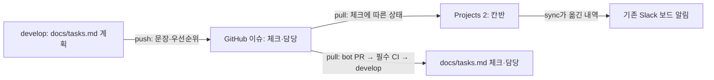

# 프로젝트 칸반과 로컬 작업

기준 보드는 [Team Bravo Finals · View 2](https://github.com/orgs/Softbank-Hackathon-Finals/projects/2/views/2)다. 저장소 `platform`의 T번호 이슈를 카드로 사용한다. PR은 해당 이슈를 `Refs #번호`로 연결한다. 일부 구현 PR이 머지됐다고 작업 전체를 닫지 않는다.



`scripts/sync_tasks.py`가 공통 로직이고 `.github/workflows/sync-tasks.yml`이 이벤트를 연결한다. `develop`의 계획 또는 스크립트 변경은 `push`, 이슈 편집·닫기·재열기·담당 변경은 `pull`을 실행한다. 봇은 `bot/sync-tasks → develop` PR을 만든다. `docs/tasks.md`만 바꾸므로 승인 없이 필수 CI 통과 후 merge commit으로 합칠 수 있다. 봇은 자동 머지를 예약하지 않으므로 팀원이 머지 버튼을 누른다. 이슈·칸반의 상태와 로컬 tasks.md 사이에는 봇 PR이 머지될 때까지 대기 시간이 생길 수 있다. 이슈 이벤트는 GitHub **기본 브랜치**의 워크플로를 사용하므로 기본 브랜치도 develop이어야 한다.

| 상태 | 사용 시점 | 자동화 동작 |
|---|---|---|
| Backlog | 시작 전, 선행 미완료 포함 | 체크 0이고 보드 밖이면 추가 |
| Ready | 선행이 끝나 착수 가능 | 담당자가 판단해 선택 |
| In progress | 실제 작업 시작 또는 일부 완료 | `start`로 시작 표시. 체크가 생겨도 자동 이동 |
| In review | 해당 작업의 PR 리뷰·CI 대기 | 담당자가 선택. `pull`은 보존 |
| Done | 전체 완료 기준 충족 | 이슈가 닫혔거나 할 일을 모두 체크하면 이동 |

보드 상태는 완료 증거를 대신하지 않는다. 진행 중 작업은 체크가 0개여도 `start`로 표기할 수 있다. 완료 체크는 PR 머지와 해당 항목 검증 뒤에 한다. T29처럼 전원 작업인 항목은 개인 ADR 하나를 썼다고 전체 체크하지 않는다. `pull`은 수동으로 선택한 In progress/In review를 체크 0이라는 이유로 되돌리지 않는다. PR 상태는 아래 `prs` 연동으로 자동 반영한다.

## 로컬 명령

레포 루트에서 실행한다. Python 3.10+, `gh` CLI가 필요하다. 토큰은 `gh auth`의 인증 저장소나 Actions `PROJECT_TOKEN`에 둔다. `.env`나 소스 파일에 복사하지 않는다.

```sh
make tasks-status                  # JSON: 카드 상태, 완료 수, 담당, 미완료 선행/통합 시점
make tasks-preview                 # GitHub·로컬 파일을 바꾸지 않는 pull 미리보기
python3 scripts/sync_tasks.py start T1 --dry-run
make tasks-start TASK=T1            # 완료 체크 없이 In progress
make tasks-tick TASK=T1 STEP=2      # 해당 PR 머지·검증 뒤에만 체크
make tasks-test
```

조회에는 `read:project`, 보드 변경에는 `project` 권한이 필요하다. 이슈 편집에는 해당 레포 쓰기 권한도 필요하다. 로컬 인증에 Projects 권한이 없으면 명확한 오류로 끝낸다. 이 경우 권한을 부여한 별도 인증을 사용하거나, 이미 설정된 Actions의 `PROJECT_TOKEN`으로 읽기 전용 조회를 실행한다.

```sh
make tasks-status-remote
gh run list -R Softbank-Hackathon-Finals/platform --workflow sync-tasks.yml --event workflow_dispatch --limit 5
gh run view <run-id> -R Softbank-Hackathon-Finals/platform --log
```

`status`는 이슈·보드 조회만 하므로 Slack 메시지나 봇 PR을 만들지 않는다. `start`는 보드만 바꾸며 로컬에서 Slack을 보내지 않는다. Slack 알림까지 필요한 작업 시작은 아래 공식 Actions 명령으로 실행한다. 실제 상태가 바뀐 경우에만 기존 Slack 경로로 알리고, 이미 시작 상태인 카드를 되돌려 알림을 재생하지 않는다.

```sh
gh workflow run sync-tasks.yml -R Softbank-Hackathon-Finals/platform --ref develop -f command=start -f task=T23 -f dry-run=true
# 미리보기 확인 후 dry-run=false로 같은 명령을 실행
```
 `tick`은 이슈 편집 이벤트를 발생시키므로 기존 Actions의 동기화·보드 이동 알림이 뒤따를 수 있다. `push`와 `pull`은 프로젝트 전체에 적용되므로 반드시 미리보기 결과를 확인한다. 타인의 완료 항목을 대신 체크하지 않는다.

새 작업 추가는 `docs/tasks.md`의 다음 빈 T번호로 하고 PR로 보낸다. 보드에 별도 draft 카드를 만들거나 같은 작업의 로컬 목록을 별도 기준으로 유지하지 않는다. 보드 카드와 PR 목록은 페이지를 끝까지 읽는다.


## PR → 칸반 연동

`sync-tasks.yml`의 `prs` 명령이 `platform → develop`과 `demo-chat → main`의 `feature/T번호-*`, `[T번호]` 제목 PR을 해당 T번호 **이슈 카드**에 연결한다. PR 카드나 별도 완료 기준을 만들지 않는다. `Status`와 텍스트 필드 `PR 상태`를 갱신하며, 이슈 체크박스·닫힘 상태·PR 병합은 건드리지 않는다.

demo-chat은 T4·T22만 지원하며 본문에 `Refs Softbank-Hackathon-Finals/platform#실제이슈번호`(또는 Closes/Fixes/Resolves)를 단독 줄로 명시해야 한다. 제목만 맞거나 `#15` 같은 로컬 참조만 있는 PR, 포크 head, 다른 대상 브랜치는 연결하지 않는다. 저장소·PR 번호를 함께 표시해 `platform#9`와 `demo-chat#9`를 구별한다. 두 저장소 조회가 모두 끝나야 쓰며 페이지 누락·API 오류를 부분 성공으로 처리하지 않는다.

| PR 상태 | 작업 카드 Status | PR 상태 필드 |
|---|---|---|
| 초안 또는 변경 요청 | In progress | 초안 / 수정 요청 + CI 상태 |
| 리뷰 대기 | In review | 리뷰 대기 + CI 상태 |
| 승인, 아직 미병합 | In review | 승인 · 병합 대기 + CI 상태 |
| 병합 / 병합 없이 닫힘, 남은 할 일 있음 | In progress | 가장 최근 PR 결과 |
| 이슈가 닫혔거나 할 일이 모두 체크됨 | Done | 마지막 PR 결과 |

여러 PR이 열려 있으면 하나라도 초안·변경 요청이면 In progress다. 나머지는 In review이며 열린 PR을 함께 표시한다. 부분 구현 PR 병합은 T1 전체 완료를 뜻하지 않는다. 완료 체크는 기존대로 **리뷰 승인 후 PR 머지와 검증을 확인한 뒤** 한다.

### 부분 PR 리뷰와 실제 작업이 동시에 진행될 때

예를 들어 T30 이미지 전달 PR이 리뷰 중이어도 목적지 VM·네트워크·복제 작업은 계속될 수 있다. 이때 담당 세션들과 카드 전체의 상태를 확인한 뒤 `activity T30 active`로 실제 작업 진행을 명시한다. 명령은 해당 이슈에 `work:active` 라벨을 붙이고 **그 카드만 In progress**로 바꾼다. `pull`·`prs`·예약 `reconcile`은 이 표시를 보존하고, `PR 상태` 필드에는 각 PR의 실제 리뷰·CI 상태를 계속 표시한다. 로컬 세션 등록이나 PR 본문에서 진행 의사를 추측하지 않는다.

```sh
python3 scripts/sync_tasks.py activity T30 active --dry-run
python3 scripts/sync_tasks.py activity T30 active
# 관련 담당자 모두가 실제 구현/검증 작업을 마쳐 PR 대기만 남았을 때
python3 scripts/sync_tasks.py activity T30 auto --dry-run
python3 scripts/sync_tasks.py activity T30 auto
```

`auto`는 진행 라벨만 제거하고 현재 PR 상태로 다시 계산한다. 변경 요청·Draft가 있거나 부분 PR만 병합됐다면 In progress, 열린 Ready PR이 있다면 In review다. 이슈가 닫혔거나 모든 항목이 완료됐으면 Done이 우선한다. 이 명령은 이슈 본문·체크·담당, PR의 Draft·승인·병합 상태를 바꾸지 않는다. 시작 권한이나 선행 완료를 부여하는 명령도 아니며, 이미 승인받아 수행 중인 작업의 상태를 기록한다. 최초 착수에는 기존 `start`와 선행 확인을 사용한다.

Projects 권한이 없는 로컬에서는 같은 명령을 공식 Actions로 실행한다. dry-run은 라벨 생성/편집과 보드 쓰기를 하지 않는다. PR 목록·보드 조회 실패 시 쓰기 전에 중단한다. 쓰기 중 실패하면 원격 상태를 다시 확인한 후 같은 명령으로 복구할 수 있다.

```sh
gh workflow run sync-tasks.yml -R Softbank-Hackathon-Finals/platform --ref develop \
  -f command=activity -f task=T30 -f activity=active -f dry-run=true
# 미리보기에서 해당 카드만 변경함을 확인한 뒤 dry-run=false로 실행
```

**platform**의 PR 생성·재열기·닫기·초안 전환·새 커밋·리뷰 요청·리뷰 제출/해제 이벤트에 실행한다. **demo-chat 이벤트가 platform workflow를 직접 시작하지는 않는다.** demo-chat 변경은 아래 수동 `command=prs` 실행 또는 예약 대조에서 조회한다. 즉시 알림이 필요하면 PR 변경 후 공식 workflow를 dispatch한다. 별도 cross-repository 쓰기 토큰이나 PR 코드 실행은 추가하지 않는다. CI 결과의 후속 변경과 누락 이벤트는 매시 17분/47분 `reconcile`(계획 push → 이슈 pull → PR 상태)로 보정한다(GitHub 예약 실행은 지연될 수 있음). 이벤트의 오래된 상태를 그대로 쓰지 않고 매번 현재 PR을 조회한다. 기존 이슈 동기화와 같은 concurrency 그룹으로 직렬화한다.

리뷰 제출/해제는 권한 없는 `pr-review-signal.yml`이 받고, 그 완료를 기본 브랜치의 `sync-tasks.yml`이 `workflow_run`으로 받는다. 신호 workflow에는 checkout·시크릿·산출물이 없다. 동기화는 신호의 상태·본문·산출물을 복사하지 않고 GitHub에서 현재 PR 상태를 다시 읽는다. 실패한 신호는 동기화를 시작하지 않으며 누락된 상태는 예약 대조로 복구한다.

토큰을 쓰는 자동 PR/review/예약 실행은 **신뢰된 workflow와 같은 커밋(`github.workflow_sha`)의 코드**를 체크아웃한다. 움직이는 `develop` 참조나 PR head를 사용하지 않아, 새 workflow와 옛 스크립트가 섞이지 않는다. 수동 dispatch는 운영자가 지정한 revision의 workflow와 코드를 함께 사용하므로 리뷰 전 `--dry-run` 검증이 가능하다. `PROJECT_TOKEN`은 기존 Actions 시크릿을 재사용하고 checkout에는 기본 읽기 토큰만 사용한다. 포크 PR 코드·제목·본문은 실행하지 않는다.

```sh
python3 scripts/sync_tasks.py prs --dry-run  # 로컬 인증에 project 조회 권한 필요
python3 scripts/sync_tasks.py prs
# 기본 브랜치에 반영 전에도 운영자가 브랜치를 지정해 검증 가능
# 실제 자동 이벤트/예약 실행 활성화는 리뷰 승인 후 develop 병합 시점이다.
gh workflow run sync-tasks.yml --ref feature/T29-review-before-merge -f command=prs -f dry-run=true
```

`reconcile`은 이벤트가 몰려 pending 실행이 대체돼도 현재 정본 계획·이슈·PR을 순서대로 다시 읽는다. 달라진 값만 쓰며, PR 리뷰는 완료 체크를 대신하지 않는다. 동기화 job은 최대 10분, 개별 gh 호출은 60초로 제한한다. 시간 초과한 쓰기를 즉시 재시도하지 않고 다음 대조에서 현재 상태를 확인한다.
