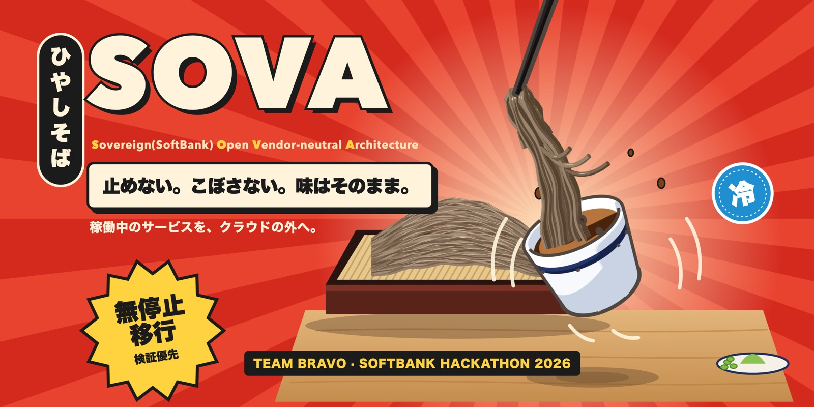

# SOVA Console (데스크톱) · T21



SOVA의 이전 운영을 한 화면에서 보는 Electron 데스크톱 콘솔이다. 대시보드와 안내자(에이전트)를 함께 담고, **SOVA MCP에만 연결된다**. 안내자는 상태를 읽고 등록 초안을 만들 수 있다. 승인·실행·되돌리기는 할 수 없고, 사람이 결정한다.

> 같은 저장소에는 이상무 님이 만든 **Sova 이전 운영 콘솔**(웹, [`services/console`](../README.md))도 있다. 두 콘솔의 차이와 감사는 [맨 아래](#다른-콘솔-sova-이전-운영-콘솔)에 적었다.

## 구조

| 부분 | 하는 일 |
|---|---|
| `src/main/sova.ts` | 루프백 프록시. 요청마다 AWS SSO STS 증명(60초, audience `sova-mcp`)을 붙여 플랫폼 MCP로 보낸다. 등록·계획 생성의 확인 호출은 **사람이 확인 창에서 누를 때까지** 보류한다 |
| `src/main/agent.ts` | 안내자. 앱에 내장한 OpenAI Codex 런타임(`@openai/codex-sdk`)으로 실행한다. 셸·앱·플러그인·브라우저·개인 MCP는 끄고 SOVA MCP만 연다 |
| `src/main/approval.ts` | 사람 승인(SHIFT). MCP를 거치지 않고 승인 호스트로 직접 보낸다. 운영자 audience(`bravo-platform-operator`) 증명과 고정 인증서를 쓴다 |
| `src/main/argo.ts` | 플랫폼·고객 클러스터의 Argo CD 애플리케이션 상태 읽기. 본인 tailnet 신원으로 API 프록시를 거치고, 먼저 클러스터 UID를 대조한다 |
| `src/main/proof.ts` | STS 서명 증명. 자격 값은 저장하지 않는다 |
| `src/renderer` | 대시보드, 이전 계획, 환경·앱 등록, 진행 타임라인, 관측·보안, 처음 안내, 설정, 안내자 패널 |
| `src/web` | 같은 화면의 웹 빌드와 사람별 서버. AWS SSO 대신 Cloudflare Access 로그인 신원을 쓴다 |

## 설치와 실행

macOS에서 Node 22와 pnpm, AWS CLI v2가 필요하다.

```sh
cd services/console/desktop
pnpm install
pnpm start                        # 개발 실행
pnpm lint && pnpm test && pnpm build
pnpm make                         # macOS 앱(DMG·ZIP). Codex 런타임을 Resources에 내장한다
```

`pnpm make`로 만든 앱은 `out/make/` 아래에 생긴다. 설정은 앱 데이터 폴더의 `settings.json`(권한 0600)에 저장된다. OpenAI API 키를 쓰면 키는 macOS 키체인(Electron `safeStorage`)으로 암호화해 저장하고, 화면에는 끝 4자리만 보인다.

## 처음 연결하기

1. **AWS SSO.** 터미널에서 본인 IAM Identity Center 프로필을 준비한다(기본 이름 `bravo-operator`, 리전 `ap-northeast-2`). 앱의 로그인 버튼은 `aws sso login --profile <프로필>`을 실행해 브라우저 로그인을 연다. 앱은 자격을 저장하지 않는다.
2. **연결 정보.** 처음 실행하면 연결 화면이 뜬다. 나중에는 **설정 › 연결**에서 바꾼다.
   - **MCP 주소:** `…/mcp`로 끝나야 한다. 예: `http://sova-mcp.<tailnet>.ts.net:443/mcp`. tailnet에 연결된 기기에서만 닿는다.
   - **AWS SSO 프로필·리전**
   - **계획 범위 고정(선택):** `plan-…` 하나만 보이게 한다.
3. **읽기 전용으로 시작한다(冷).** 처음에는 상태·진행·관측만 읽는다. 안내자 입력창 아래의 `冷 읽기 전용 / 書 등록 허용`으로 바꾸고, 등록을 허용해도 등록마다 미리보기와 확인 창을 거친다. 이 스위치로도 승인·실행은 열리지 않는다.
4. **안내자 인증(설정 › 안내자).** 둘 중 하나를 고른다.
   - ChatGPT 계정 로그인
   - 본인 OpenAI API 키. 이 경우 API로 쓸 수 있는 모델만 보인다.
5. **사람 승인 호스트(설정 › 연결, 선택).** SHIFT를 이 앱에서 승인하려면 세 가지를 넣는다.
   - 승인 호스트의 tailnet 이름
   - 인증서 이름(기본 `t15-rehearsal-host.platform-state.svc`)
   - 공개 PEM 인증서. 인증서는 고정돼 있어서, 다르면 `approval_certificate_mismatch`로 거부한다.
6. **클라우드 계정(설정 › 클라우드 계정, 선택).** AWS 포털 역할 확인, GCP 프로젝트 ID, tailnet 이름을 넣으면 각 콘솔로 바로 갈 수 있다.

## 화면

| 메뉴 | 볼 수 있는 것 |
|---|---|
| 대시보드 | 계획의 단계 레일(수집 → … → 감시), 실시간 이벤트, 다음 행동, 관측 요약, 플랫폼·고객 Argo CD 상태 |
| 이전 계획 | 계획 목록과 상세, 실행 상태(run-state), 권한이 있으면 SHIFT 승인 |
| 환경·앱 등록 | 출발지·목적지 환경과 워크로드 등록 초안. 입력 검사 뒤 확인 창에서 사람이 누를 때만 등록된다 |
| 진행 타임라인 | 단계 전이와 판정 이벤트의 시간순 기록 |
| 관측 · 보안 | 경보, 트래픽(RPS·p95·오류율), 데이터 경로(논리 복제 지연·PgBouncer), 구성 요소 상태, 보안 발견 |
| 처음 안내 | SOVA 흐름과 콘솔 사용 순서 |
| 안내자 패널 | 모델·추론 수준 선택, `/` SOVA 프롬프트, `@` 계획·환경 언급, 대기열, 세션 관리(고정·검색·분기·보관) |

주요 단축키는 다음과 같다. 전체 목록은 **설정 › 키보드 단축키**에 있다.

| 키 | 동작 |
|---|---|
| `⌘K` | 명령 팔레트 |
| `⌘N` | 새 채팅 |
| `⌘1`–`⌘9` | 채팅으로 이동 |
| `⌘F` | 채팅에서 찾기 |
| `⌘⇧E` | 추론 수준 전환 |
| `⌘Enter` | 작업 중 지금 조정 |
| `Esc` | 안내자 중지 |

`sova-console://open?plan=…` 링크를 열면 앱이 해당 계획으로 이동한다.

## 로컬 시험(합성 데이터)

플랫폼 없이 화면만 볼 때 쓴다. 배포용이 아니다.

```sh
cd services/sova-mcp && uv run python tests/dev_server.py   # http://127.0.0.1:8765/mcp
```

설정 › 연결에서 MCP 주소를 `http://127.0.0.1:8765/mcp`로 바꾸고, **로컬 시험 토큰**에 `dev-local`을 넣는다. 루프백 주소일 때만 이 토큰을 쓰며, 상단에 "로컬 시험 데이터"가 표시된다.

## 웹 버전

`pnpm build:web`과 `web.Dockerfile`은 같은 화면을 브라우저용으로 빌드한다. 플랫폼 클러스터의 `sova-console-web`이 이를 제공하며, 사람 신원은 Cloudflare Access 로그인에서 받는다. MCP 주소·AWS 프로필·승인 호스트 설정은 데스크톱 앱에만 있고, 웹에서는 승인할 수 없다. 고객 클러스터의 Argo CD는 본인 tailnet 신원이 필요해서 데스크톱 앱에서만 보인다.

## 한계

- 실환경 해피패스에서 GATE PASS 이후 단계를 이 콘솔로 끝까지 따라간 적은 없다. 데모는 데모 모드 계획으로 진행했다. [회고와 한계](../../../docs/retrospective.md)를 본다.
- 안내자의 답은 SOVA MCP의 읽기 결과에 기대며, 판정의 근거가 아니다. 판정은 플랫폼의 결정적 코드가 한다.
- macOS 빌드만 확인했다.

## 다른 콘솔: Sova 이전 운영 콘솔

[`services/console`](../README.md)은 **이상무 님이 만든 웹 운영 콘솔**이다(T21). 플랫폼 호스트의 T10 API 옆에 붙어 같은 출처의 세션으로 동작한다. 다음 화면이 있다.

- 보안 통제 보고서(T19)
- 탐지 요약(T33)
- 상세 모니터링(T37)
- 출발지 복귀 이력(T20)
- 워크로드 격리·대응 지도
- 공유 네트워크 아틀라스
- 감사 기록
- 비용·예산

실행과 운영 호스트 연결 방법은 그 README의 "연결 방법"과 "운영 호스트 연결"을 따른다.

| | 이 데스크톱 콘솔 | Sova 이전 운영 콘솔 |
|---|---|---|
| 형태 | Electron 앱(+웹 빌드) | 플랫폼 호스트에 붙는 웹 화면(`bravo_console`) |
| 연결 | SOVA MCP 하나 | T10 HTTP·SSE API 직접 |
| 사람 신원 | 본인 AWS SSO 증명(웹은 Cloudflare Access) | 호스트가 검증한 세션 |
| 강점 | 안내자와 대화하며 등록·상태 파악 | 보안·관측·복귀·감사를 근거별로 나눠 보여 주는 운영 화면 |

이상무 님은 본선 동안 보안 통제 시험(T14), 원본 대조 게이트(T19), 관측(T34·T36·T37), 탐지 통합(T33), 보안 검토 흐름을 맡았다. 그 결과를 사람이 읽을 수 있는 화면으로 엮은 것이 이 콘솔이다. 화면마다 원칙이 일관되게 지켜진다. 등록된 계획과 실제 관측을 구분해 보여 주고, 관측이 15초 넘게 끊기거나 권한이 회수되면 표시를 지우며, 화면 애니메이션으로 값을 지어내지 않는다. 보안을 앞세운 팀에서 그 보안을 끝까지 눈에 보이게 만든 작업이다. 깊은 존경과 감사를 남긴다.
