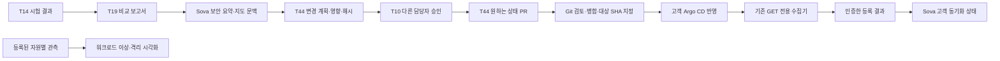

# 보안 시험 → IaC 승인 → 고객 동기화

T21 소비자 연결 문서. 기존 T14/T19 판정, T10 승인, T44 IaC 계획과 고객 GitOps 수집기를 재사용한다. Sova의 기존 화면·워크로드 지도·운영 조작을 유지하며 별도의 실행기나 판정기를 만들지 않는다.

## 화면과 책임

| 위치 | 표시·동작 | 별도로 필요한 근거 |
|---|---|---|
| 보안·거버넌스 / 워크로드 지도 | 같은 계획의 프로필·시험 수·출발지/목적지 결과·T19 판정 | T19의 원문·실행 환경·증거 |
| 워크로드 지도 | 관측된 이상·보류·격리·대체·경로·복구를 기존 노드와 연결에 표시 | 등록된 자원 UID에 결속한 워크로드 관측. 시험 FAIL만으로 노드를 격리 상태로 만들지 않음 |
| IaC·고객 환경 | 변경 계획 저장·조회, 다른 담당자 승인·조회, 해당 변경의 PR 생성 | T44 API, 현재 사람 권한, 같은 계획 ID·해시·요청자 |
| IaC·고객 환경 / 모니터링 | 기반 설치·정지·진행·재시도·지정 커밋 반영 확인 | 등록된 클러스터 UID, 검토한 커밋, 고정 생산자 버전, 인증된 수집 결과 |

보안 비교의 `PASS`는 전환 허가가 아니다. 고객의 `SYNC_VERIFIED`는 GitOps에서 지정한 커밋의 반영만 뜻하며 데이터 보존·보안 동등성·서비스 무중단을 판정하지 않는다. 수집 연결이 없거나 증거가 잘못되면 `UNCONFIGURED`·`UNKNOWN`으로 남는다.

화살표는 제품 흐름이며 자동 실행 체인이 아니다. 콘솔은 보안 FAIL을 읽어 임의 IaC 변경안을 생성하거나 PR을 병합·동기화하지 않는다.

## IaC API 소비

기존 T44 API 계약을 사용한다. 구현 기준은 [PR #628](https://github.com/Softbank-Hackathon-Finals/platform/pull/628)의 `51482e6f`다. 작업 중 해당 PR이 `c1504a26`으로 병합되어, 최종 통합은 이를 포함한 `develop`의 `3d41305c`를 반영했다. 병합과 운영 호스트 배포·등록은 별개다.

| 요청 | 기존 권한·검사 |
|---|---|
| `POST /v1/plans/{plan}/iac/plans` | 현재 `apply_infra`, 등록된 카탈로그 모듈·설정 검증, 멱등 키 |
| `GET /v1/plans/{plan}/iac/plans/{id}` | 현재 계획 읽기 권한, 저장된 계획·PR 조회 |
| `POST /v1/plans/{plan}/approvals` (`approval_kind=infra`) | 현재 `approve_infra`, 요청자와 다른 사람, 유효기간·계획 상태 |
| `GET /v1/plans/{plan}/infra-approvals/{id}` | 현재 읽기 권한, 승인 회수·사용 이력 조회 |
| `POST /v1/plans/{plan}/iac/plans/{id}/pull-request` | 기존 승인 결속·1회 claim·현재 권한·다시 계산한 해시 검사 |

승인 binding은 **`infra_plan_id`, `plan_digest`, `requested_by`**다. T10 이벤트의 승인 enum에 `infra`를 추가하지 않는다. 이 승인은 PR 생성 경로의 승인이고, 클러스터 직접 적용이나 DB 전환 권한이 아니다. 화면은 API가 제공하는 변경 건수와 영향 요약을 보여주며, 전체 파일 차이는 생성된 PR에서 검토한다. 전체 diff를 승인 전에 제공하는 API라고 표시하지 않는다.

응답 유실 시 자동 재전송하지 않는다. 계획 생성은 기존 API의 결정적 ID를 계산해 GET으로 조회하고, PR 생성은 같은 계획의 저장된 PR을 조회한다. 승인 응답에서 승인 ID 자체를 받지 못하면 현재 API에는 키로 승인 ID를 찾는 GET이 없음을 알리고, 본문·멱등 키를 고정한 명시적 복구만 제공한다. 승인 만료·권한 회수·계획 변경 시 새 실행은 잠긴다. 미확인 요청은 창 안에 보존하며 닫기 경고를 제공한다. 브라우저 새로고침 후 자동 복구되는 영속 클라이언트 원장이라고 주장하지 않는다.

## 호스트 연결

`PlanDelivery`는 `ConsoleApp`과 **동일한 T10 ASGI 인스턴스**에 연결한다. `compose_console(..., delivery=reader)`가 다른 인스턴스의 reader를 거부한다. `GET /v1/plans/{plan}/delivery`는 읽기 전용이고 query·POST로 등록 정보를 바꿀 수 없다.

호스트에서 다음 항목을 주입한다.

1. `authorize(scope, snapshot, permission)`: 현재 세션의 계획 접근과 `read`·`apply_infra`·`approve_infra` 권한. T10의 실제 `OperatorAccess`와 신원 확인을 재사용한다. 공개 snapshot에는 tenant가 없으므로 신뢰하는 DB 계획을 조회해 검사한다. 브라우저가 보낸 사용자명·역할을 사용하지 않는다.
2. `subject(scope, snapshot)`: 같은 세션 검증기가 확인한 사용자 ID.
3. `modules`: `environment_id`, T44 환경 이름, 모듈, 비밀값 없는 초기 params의 고정 목록. 목록은 편집 가능한 브라우저 등록부가 아니다. 최종 params 검사는 T44 카탈로그가 한다.
4. `targets`: `CustomerTarget(environment_id, environment, cluster_uid, reviewed_revision, producer_revision, provenance)` 목록. 원하는 상태 커밋과 수집기 코드 커밋은 별도로 고정한다. `provenance`는 `live`·`synthetic`·`historical`이며 화면에도 구분한다.
5. `load_sync(scope, snapshot, target)`와 `authenticate_sync(...)`: 신뢰하는 수집·등록 저장소의 결과와 그 인증. 생 JSON의 자기 주장이나 해시 일치만으로 인증하지 않는다.

고객 수집은 기존 [`customer_status.inspect`](../../../infra/iac/customer_status.py)를 사용한다. 등록한 클러스터 UID·검토 SHA·전용 읽기 경로로 외부 수집기가 GET 검사를 수행하고, 그 결과를 신뢰하는 저장소에 게시한다. 웹 콘솔에 kubeconfig·클러스터 관리자 권한을 넘기지 않는다.

등록 단위 `RegisteredCustomerSync`는 계획 ID·digest·version·환경·클러스터 UID·생산자 SHA·내용 해시·원문 bytes다. 인증기는 해당 등록부의 원본, 접근 권한, 생산자 SHA, 계획 결속을 확인해야 한다. 예를 들어 기존 T7 자격과 T24의 버전 있는 저장 영수증을 사용하는 경우에는 그 **실제 읽기 검증 결과**를 사용한다. 임의의 새 서명 문자열을 권한 근거로 만들지 않는다.

소비자는 수집기 출력을 다시 판정하지 않고 형식·범위·정확한 결속·인증·만료를 검사한다. 계획과 권한은 수집 전후에 재조회한다. 생산자 버전 불일치, 다른 UID·환경·계획, 미래/만료 관측, 원문 변조는 성공을 철회한다. 원문·자격·임의 오류 메시지는 화면에 반환하지 않는다. 조회 권한 표시는 최대 15초, 고객 관측은 최대 5분이며 HTTP 재조회가 오래된 관측 수명을 늘리지 않는다.

재시도 세분화 생산자는 [PR #677](https://github.com/Softbank-Hackathon-Finals/platform/pull/677)에 있다. 미반영 생산자가 `SYNC_IN_PROGRESS`만 반환하면 재시도 횟수를 임의 추정하지 않는다.

## 검증 및 운영 인수

로컬 시험과 공용 환경 인수를 구분한다. 시험용 신원·Git 저장소·클러스터 응답 fixture는 실제 고객 환경 인수가 아니다.

- `tests/security-progress.test.js`, `delivery-model.test.js`: 보고서 만료·계획 불일치, 승인 결속·자기 승인·회수·만료, 다른 PR·URL 거부.
- `tests/test_delivery.py`: 실제 T10 세션/계획 검사, 잘못된 등록·클러스터 UID·생산자 버전, 수집 중 권한 회수, 실제 GET 전용 수집기 출력 소비.
- `tests/test_delivery_native.py`: 기존 T44/T10 구현의 실제 권한·승인·claim·중복 PR 방지. #628이 없는 과거 기준에서는 의존성 skip으로 보고하며, 최종 통합 기준에서는 일반 전체 시험에 포함한다.
- `tests/browser/delivery.spec.js`: 같은 계획의 보안 요약·지도, 요청 응답 유실과 GET 복구, 다른 담당자의 승인, 권한 감소, 미연결 잠금, 데스크톱·모바일 배치. IaC HTTP 응답은 명시적 브라우저 계약 fixture다.

공용 운영 인수는 다음을 별도로 수행해야 한다.

1. #628을 포함한 소비 경로 lockfile의 `--locked` 검증을 유지하며, 실제 호스트에 기존 IdP/OperatorAccess를 주입.
2. 고정 GitHub App과 실제 IaC 저장소로 다른 담당자의 승인·PR 생성·권한 회수·응답 유실 인수.
3. 고객 수집기와 인증된 등록 저장소를 연결하고 등록 UID·SHA·생산자 버전을 대조.
4. 실제 양쪽 환경의 보안 보고서와 자원별 대응 관측을 연결. 목적지 IAM-01.1 실패를 숨기거나 PASS로 대체하지 않음.
5. 실제 고객 반영·정지·재시도·만료를 같은 계획에서 확인하고, 별도의 데이터·보안·복구 시험과 함께 전체 시연 인수.

이 UI 변경으로 공유 클러스터를 배포·patch·restart·exec하거나 DB·Edge·네트워크·권한을 변경하지 않았다.
