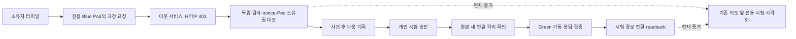

# 실제 설정 지도와 터미널 워크로드 시험 연결

기존 Sova 콘솔과 AWS·온프렘의 조회 전용 설정 지도를 유지한다. 소스 체크아웃용
`testing/terminal_trial_host.py`만 별도 전용 시험 패널을 삽입한다. 운영 콘솔의
설치 패키지·T10 계약·원본 게이트·실행기·RBAC는 변경하지 않는다.

## 사용 흐름

1. 로컬 소유자 인증 후 별도 시험 자원 생성에 동의한다.
2. 준비된 시험에 대해 터미널의 고정 `attempt` 명령을 실행한다.
3. 실제 비인가 내부 HTTP 요청의 403, 주체 Pod·Deployment 및 독립 감사를 확인한다.
4. 사건 이후 생성한 정확한 대응 계획에 동의한다.
5. 실제 새 연결 격리·Green 기동·응답·시험 경로 전환을 지도와 단계별 근거에서 확인한다.
6. 종료 후 소유 자원 정리 결과를 확인한다. 세션 회수·관측 만료 시 지도를 철회한다.

## 신뢰 경계

- `/__trial`은 별도 개인 시험 능력이다. native `/v1` 변경은 계속 405다.
- 정적 JS/CSS에는 자격이나 제어 nonce가 없다. 상태·feed는 조회 인증(`authorize`), 제어는 별도의
  소유자 인증(`authorize_control`)이 필요하다. 두 함수는 같은 것을 넘길 수 없다. 지켜볼 수 있는 세션이
  그 권한만으로 클러스터 효과를 내지 못하게 하기 위해서다.
- Host·Origin·CSRF·JSON 중복 키·크기를 검사한다. `Sec-Fetch-Site`는 없거나 `same-origin`이어야 한다.
  쿠키는 포트로 나뉘지 않아 같은 PC의 다른 `127.0.0.1` 포트도 `same-site`이기 때문이다(#727).
- 제어 문서는 호스트에서 정확히 `action`·`request_id`·`session_id`·`plan_digest`·`approved`만 받는다.
  `session_id`·`plan_digest`는 지금 manager 상태와 같아야 하고, prepare·respond는 `approved: true`가 필요하다.
  manager는 실행 때 범위와 동의를 다시 확인한다.
- **아직:** 이 호스트를 조립하고 소유자 쿠키를 발급하는 런처는 이 저장소에도, sova-test #3에도 없다.
  sova-test에는 `demo/operator_auth.py`(소유자 bootstrap 인증)만 있다. 런처를 넣어 리뷰를 받기 전에는
  실제 클러스터 효과를 내는 경로의 사람 인증이 검토되지 않은 상태다.
- 브라우저는 고정 prepare/respond/stop만 사용하며 요청의 대상·URL·명령을 지정하지 못한다.
  실제 접근 시도는 별도 소유자 터미널 명령으로만 시작한다.
- HMAC·생산자 SHA·계획·현재 session·관측 revision을 검증한다. 앞선 session이나
  뒤처진 관측, 변조·만료·실행 권한을 주장하는 문서는 거부한다.
- 실제 행동은 기존 Sova 시험 감독기·security 가드·효과 원장을 재사용한다.
- 세 개의 새 시험 namespace만 사용한다. 기존 운영 앱·DB·Edge는 변경하지 않는다.

## 주장 범위

실제 403은 고정 접근 시도가 거부됐다는 뜻이며 일반 공격 탐지나 침해를 뜻하지 않는다.
현재 격리는 독립 확인 Pod에서 원본으로 향하는 새 HTTP 연결 거부에 한정한다.
이웃 정상 응답을 함께 확인하며 egress·기존 연결 전체의 봉쇄로 확대하지 않는다.
같은 온프렘 안의 전용 시험이며 AWS→온프렘 이전이나 무중단 운영이 아니다.
개인 시험 승인은 제품 T10 승인·기업 인증·운영 인수를 대신하지 않는다.

## 소스와 검증

시험 생산자와 비공개 설정은 별도 `sova-test` 체크아웃을 SHA로 고정한다.
security 코드·이미지·문서 SHA와 실제 실행한 생산자 SHA는 분리한다.
원본 접근 자료와 실제 Pod UID·영상은 비공개로 보존한다.

- 플랫폼 호스트 경계 시험: 26개 통과(#905 리뷰 반영 뒤). 모의 manager이며 클러스터 증거가 아니다.
- 콘솔 전체 Python: 525개 통과. PostgreSQL 시험은 임시 로컬 DB다.
- 최신 develop 기반 JavaScript: 316개, 자산 검사 및 새 JS 구문 검사 통과.
- 실제 시험의 네 효과 확인과 마지막 화면 확인은 별도다. 마지막 관측 게시 전에
  완료를 표시하던 경합을 수정하고, 뒤처진 revision을 거부하는 시험을 추가했다.
- 실제 UI 최종 인수: 터미널 HTTP 403·주체·독립 감사, 승인 후 네 효과와
  화면 8단계 모두 확인. 이웃 정상 응답·소유 자원 정리·세션 철회 통과.
  공개 요약은 `docs/evidence/t21-terminal-response-2026-11-08/summary.json`이다.
- 실제 생산자 `3ab5dd3aa2aaf4bc2169526f67e9de3f1d4cf7ba`는
  [Sova 개발 기록](https://github.com/Softbank-Hackathon-Finals/sova-test/blob/feature/terminal-workload-response/docs/development/terminal-workload-response-2026-11-08.md)에
  별도로 기록했다. 503으로 중단한 이전 실행과 조기 완료 표시의 부분 검증도 보존한다.

운영 T10 권한·공유 해피패스 인계는 #872에서 계속 추적한다. 이 변경으로
T14·T19·T21·T22의 운영 완료 체크를 대신하지 않는다.
