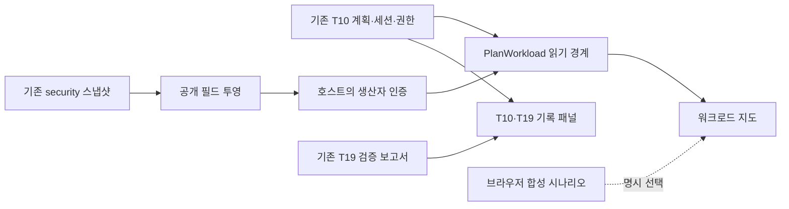

# 워크로드와 보안 대응 지도

상태: 로컬 구현·검증. 운영 생산자 등록과 실환경 대응 인수는 미완료.

기존 Sova 사이드바·워크스페이스·승인·모니터링 화면을 유지하고, 워크로드 카드에
자원별 상태와 대응 근거를 추가한다. 현재 계획의 출발지·목적지 등록 정보는
`등록된 이전 경로 보기`에서 계속 확인할 수 있다.

## 화면에서 확인하는 것

| 표시 | 의미 | 의미하지 않는 것 |
|---|---|---|
| 회색 선 | 등록된 의존성 | 실제 통신 성공 |
| 움직이는 파란 선 | 해당 연결에 유효한 관측 근거 존재 | 패킷 이동·트래픽 양의 실측 |
| 주황색 자원 | 등록된 보안 이상 근거 | 공격 확정 |
| 주변 영향 강조 | 선택 자원에서 이어진 의존성 | 주변 자원의 침해 확정·격리 범위 승인 |
| 차단 요청 | 요청 기록 | 차단 완료 |
| 붉은 점선·끊김 표시 | 해당 자원/연결의 격리 확인 근거 | 모든 세션·우회 경로 차단 |
| 미확인·만료 | 현재 상태를 확인할 수 없음 | 정상·복구 완료 |

노드는 앱, 작업자, DB, 저장소, 큐, 신원, 비밀 참조, AI, 관측, 진입점과 보호·실행
구성 요소를 지원한다. 최대 48개 자원과 96개 관계를 표시하며, 위치 힌트가 겹쳐도
서로 다른 위치를 배정한다. 자원 선택은 읽기 동작이다. Shift와 함께 선택하면 여러
자원의 관계를 강조한다. 실제 명령·격리·배포 API를 호출하지 않는다.

`이상 확인 → 보안 보류 → 사람 승인 → 격리 → 대체 준비 → 독립 검증 → 경로 전환 → 복구 확인`
각 단계는 별도 기록이다. 이전 단계의 성공을 다음 단계의 성공으로 추정하지 않는다.
서비스 복구와 사고 보류 해제도 별개다.

## 출처를 분리한다

- **플랫폼 관측:** 호스트가 등록하고 인증한 생산자의 자료만 소비한다. 기본값은 미연결이다.
- **서버 합성 시험:** 실제 HTTP·T10 조회 경계를 지나지만 자원과 효과는 시험 데이터다.
- **로컬 시나리오:** 브라우저 메모리에서만 재생한다. HTTP 변경 요청, 실제 승인·격리,
  지속 저장을 하지 않는다. 정상·검증 실패·근거 만료 장면을 선택할 수 있다.
- **과거 관측:** 기록을 볼 수 있지만 현재 성공 표시에는 사용하지 않는다.

플랫폼 생산자가 없을 때 자동으로 합성 성공 장면을 대신 보여주지 않는다.
사용자가 `로컬 시나리오`를 명시적으로 선택해야 재생된다.

## 기존 T10·T19와의 관계

T10 snapshot·SSE와 T19 보고서는 기존 `model.js`의 검증 함수를 그대로 사용한다.
`SAFE_HOLD`는 계획 보류이며 공격·격리의 증거가 아니다. T19 PASS 역시 선정 통제의
비교 결과다. 실제 워크로드 격리, DB 무중단 이전이나 목적지 운영 자격으로 확대하지 않는다.

이 흐름에는 실행기로 이어지는 경로가 없다. 기존 T7/T9 자격 관리, T10 승인·잠금,
T19 판정, T31/T12 실행·복구를 대체하지 않는다.

## 호스트 연결

`GET /v1/plans/{id}/workload`는 동일 출처의 읽기 전용 경로다. POST는 405,
쿼리로 생산자를 선택하려는 요청은 400, 생산자 미등록은 503으로 끝난다.

호스트는 다음 의존성을 명시적으로 조립한다.

1. `PlanWorkload(api, load, authorize, authenticate, producer_id, source_revision)`.
2. `api`는 현재 콘솔이 쓰는 T10 API다. 별도 사용자·테넌트 판단기를 만들지 않는다.
3. `load(scope, plan)`은 현재 계획에 등록된 읽기 전용 자료를 반환한다. 브라우저의
   주소·파일 경로·토큰을 공급자 선택에 사용하지 않는다.
4. `authorize`는 현재 계획의 자료 열람 권한을 확인한다.
5. `authenticate`는 서버 등록, 서명 또는 기존 신뢰 경계로 생산자와 원문을 인증한다.
   JSON의 `provenance` 문자열이나 SHA 일치만으로 인증을 대신하면 안 된다.
6. 결과는 `RegisteredWorkload`이며 고정 producer ID·40자리 코드 SHA·본문 SHA-256과
   bytes를 포함한다. 검증 후에만 `ConsoleApp(..., workload=reader)`에 연결한다.

조회 전후로 계획·권한·생산자 인증을 다시 확인한다. 계획 ID/digest/version, 양쪽 환경,
앱이 달라지면 읽던 결과를 버린다. 제공자는 네트워크·DB 자체 타임아웃도 설정해야 한다.
호출 대기는 최대 5초, 동시 읽기는 최대 4개다. 시간 초과된 동기 읽기는 실제 종료할 때까지
슬롯을 유지하므로 취소할 수 없는 쓰레드를 계속 생성하지 않는다. 포화는 503이며 성공으로
표시하지 않는다. 프로세스 종료·provider close 책임은 호스트에 있다.

## 표시 문서의 불변조건

`console-workload.v1`은 표시 형식이며 승인·실행 계약이 아니다. `authorizes_execution`
값은 항상 false다. 서버와 브라우저가 같은 범위의 검사를 수행한다.

- 계획 ID/digest/version 일치, 유효한 stream ID와 단조 증가 revision.
- 관측 시각의 미래 이동 금지, 유효기간 최대 5분. HTTP 조회로 원래 유효기간을 늘리지 않음.
- 자원·관계·근거 ID 중복과 끊어진 참조 거부. 교체된 자원의 이전 UID 근거 재사용 금지.
- 응답·보안·격리·경로 근거의 종류와 대상 일치. 한 자원의 근거로 여러 자원의 단계 완료를 표시하지 않음.
- 필드 허용 목록·120 KB 응답 제한·자격증명 형식 거부. 임의 로그·명령·Secret 원문 미수록.
- 늦은 revision은 최신 결과를 덮지 못함. 같은 revision의 내용 충돌과 stream 변경은 미확인으로 전환.
- 명시적 `관측 다시 연결`은 읽기 상태만 초기화함. 실행을 재시도하지 않음.
- 세션/권한 회수는 화면 자료 삭제. 응답 지연 중 계획 변경도 이전 결과를 복원하지 못함.

모든 증거가 실제로 무엇을 측정했는지는 생산자와 독립 검증의 책임이다. 이 형식 검사가
형식만 올바른 허위 자료를 진실로 만드는 것은 아니다.

## security 저장소 연결

`sova_security.adapters.console_workload.project_security_snapshots`는 기존
`SecuritySnapshot`·`SystemGraph`·`PostureFinding`을 재사용한다.

- 현재 테넌트·앱·출발/목적지에 결속된 스냅샷만 수용한다.
- 구성 위반은 경고로 표시한다. 구성 PASS로 실행 상태나 전반적인 안전을 확인했다고 하지 않는다.
- 관계는 등록 관계로 유지한다. 통신 관측·격리·대체·복구는 별도 영수증이 필요하다.
- 로컬 그래프를 `live`로 바꿀 수 없다. 자원 원문 이름·경로 대신 불투명 식별자를 사용한다.
- 이 어댑터 추가는 기존 `546f6e0` 이미지 자격에 포함되지 않는다. 별도 코드·산출물 검증이 필요하다.

## 실환경 인수에서 남은 것

| 대상 | 필요한 연결·변경 | 인수 방법 |
|---|---|---|
| 조회 호스트 | 기존 IdP/T10 권한과 생산자 등록, 읽기 전용 저장소 연결 | 올바른 계획은 조회, 다른 테넌트·철회된 생산자·만료 자료는 거부/미확인 |
| 실자원 지도 | 양쪽 현재 자원 UID·환경 등록과 스냅샷 수집 | 실제 UID 교체·관계 변경 시 기존 근거가 재사용되지 않음 |
| 격리 표시 | 기존 실행·효과 원장의 독립 readback 참조 | 요청만 있을 때 완료 미표시, 실제 거부 탐침 확인 뒤 지정 자원만 표시 |
| 대체·전환·복구 | T31/T12 및 해당 대응 실행기의 확인된 영수증 | 응답 유실·실패·재시작에도 자동 성공/재실행 없음 |
| 감사 | 기존 T24 기록 ID와 실행·검증 근거의 결속 | 같은 ID로 조회 및 보존 인수; raw 명령·비밀값 비노출 |
| 배포 | 이미지/설정/생산자 버전의 일치와 별도 배포 창 | 현재 승인된 배포 경로에서 확인. 로컬 시험을 운영 인수로 대체하지 않음 |

이번 구현은 공용 리소스의 배포·exec·권한 변경·철회·컷오버를 수행하지 않았다.
팀의 T21 완료 체크와 운영 PASS는 변경하지 않는다.
